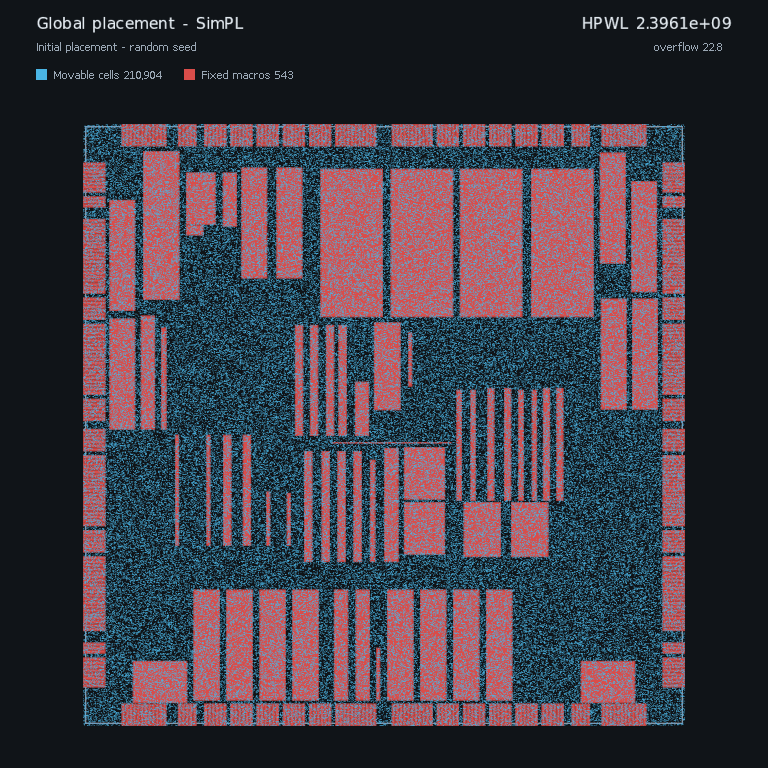
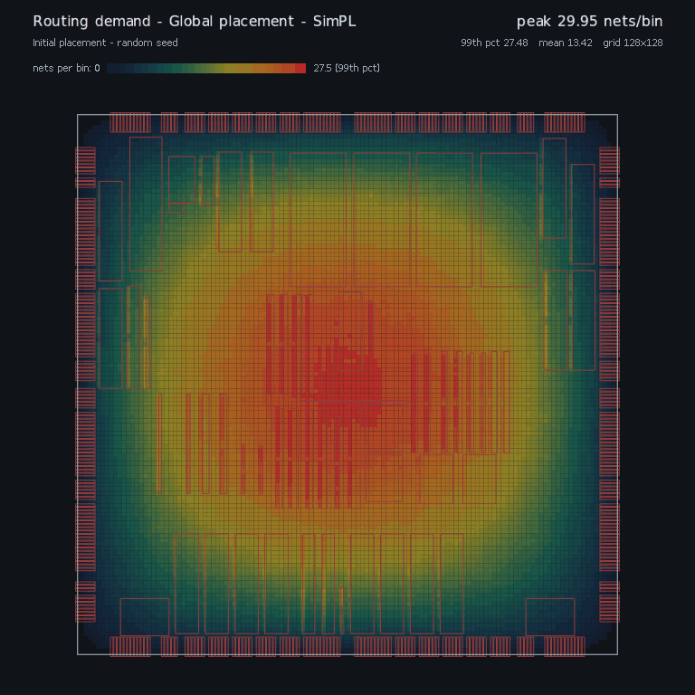
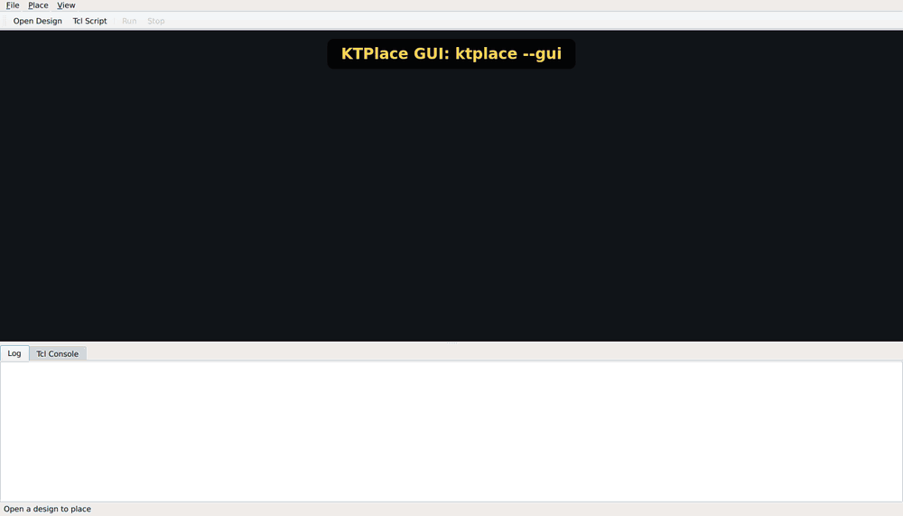

<h1 align="center">KTPlace</h1>

<p align="center">
  <b>An open-source know thyself placement engine.</b><br>
  SimPL global placement, Abacus legalization and FastDP detailed placement in modern C++,<br>
  driven from the command line, a Tcl shell or a GPU-drawn desktop GUI.
</p>

<p align="center">
  <a href="https://github.com/coherent17/KTPlace/actions/workflows/ci.yml"></a>
  <a href="https://github.com/coherent17/KTPlace/releases"></a>
  <a href="LICENSE"></a>
  
  
</p>

<p align="center">
  <a href="#quick-start">Quick start</a> ·
  <a href="#results">Results</a> ·
  <a href="#tcl-flows-and-the-console">Tcl flows</a> ·
  <a href="#desktop-gui">GUI</a> ·
  <a href="#configuration">Configuration</a> ·
  <a href="#install-a-release">Install a release</a>
</p>

<p align="center">
  
  
</p>

<p align="center"><sub>
adaptec1 (ISPD 2005) with the default flow, ending at an HPWL of 7.94e7. Right: the same run's routing
demand, frame for frame; each net spreads one unit over its pins' bounding box (1/(w·h) per unit area).
Drawn with <code>anim_zoom 1</code>, <code>anim_blend 1</code>, <code>simpl trace_every 3</code> and <code>abacus frames 16</code>.
</sub></p>

<p align="center">
  
</p>

<p align="center"><sub>
The desktop GUI on adaptec1: open a design, step through the flow from the Tcl Console, follow a
high-fanout cell through every stage, and right-click for the routing-demand map.
</sub></p>

## Highlights

- **A complete flow.** SimPL (B2B net model, look-ahead legalization) or NTUPlace for global
  placement, Abacus or a multi-row legalizer, FastDP detailed placement, and an independent
  legality check (overlaps, die, fences) after every stage.
- **Fences and multi-row cells.** Region constraints from ISPD 2015 and cells taller than a row.
- **Bookshelf and LEF/DEF.** The format is detected from the directory; gzipped files are read directly.
- **Scriptable.** Every step is a Tcl command: run a script, type into `ktplace --shell`, or use the GUI's console.
- **Deterministic.** Linux and macOS write byte-identical placements, and CI checks it on every change.
- **Pictures built in.** An animated GIF of the run, a routing-demand GIF in step with it, a
  high-resolution final image and the SimPL convergence plot, all rendered in C++ with no external tools.
- **Self-contained.** oneTBB, zlib and CImg are submodules linked into the binary; a release runs on any x86-64 Linux.

## Quick start

```sh
git clone --recurse-submodules https://github.com/coherent17/KTPlace.git
cd KTPlace
make -j"$(nproc)"
source ktplace.sh
ktplace benchmark/bookshelf/ICCAD04/ibm01 -w output/ibm01
```

`output/ibm01` then holds `placed.pl`, `plots/placement.gif`, `plots/routing_demand.gif`, the final
`plots/placement.png`, SimPL's `plots/simpl_convergence.png` and the logs.

## Results

HPWL after detailed placement on ISPD 2005, every placement legal by ktplace's own check
([`benchmark/bm_status.md`](benchmark/bm_status.md), which also covers the fenced ISPD 2015 designs
against DREAMPlace 3.0):

| design | KTPlace | SimPL | gap | runtime |
| --- | ---: | ---: | ---: | ---: |
| adaptec1 | 7.944e7 | 7.687e7 | +3.3% | 22.4 s |
| adaptec2 | 1.022e8 | 9.037e7 | +13.1% | 25.4 s |
| adaptec3 | 2.218e8 | 2.064e8 | +7.5% | 49.6 s |
| adaptec4 | 1.908e8 | 1.860e8 | +2.6% | 55.1 s |
| bigblue1 | 9.892e7 | 9.585e7 | +3.2% | 28.6 s |

## Usage

```sh
ktplace <input_dir> [options]
ktplace benchmark/bookshelf/ICCAD04/ibm01 -w output/ibm01
```

A directory with a `.def`/`.def.gz` is read as LEF/DEF, anything else as Bookshelf.

| option | meaning |
| --- | --- |
| `-w, --work-dir <dir>` | where everything is written (default: cwd) |
| `-tcl, --tcl <file>` | Tcl script that configures the run, or is the run (below) |
| `--shell` | interactive Tcl console (prompt on stderr) |
| `--gui` | the desktop window (needs `make GUI=1`) |
| `-v, --verbose` | also echo the trace log to the console |

Everything a run writes goes under `-w`: `placed.pl`, `plots/` (`placement.gif`, the matching
`routing_demand.gif`, the final `placement.png` and SimPL's `simpl_convergence.png`), `ktplace.log`
and `ktplace_trace.log`. stdout is never written.

## Tcl flows and the console

The flow is also a set of Tcl commands, so a script can be the run itself:

```tcl
# flow.tcl:  ktplace -w output/ibm01 -tcl flow.tcl
add_option simpl grid 64
read_design benchmark/bookshelf/ICCAD04/ibm01
gplace_design                  ;# or: gplace_design ntuplace1
puts "after global placement: [report_hpwl]"
legalize_placement
detail_place
check_placement
write_placement                ;# <work-dir>/placed.pl, or write_placement <file>
```

| command | does |
| --- | --- |
| `read_design [dir]` | load a Bookshelf or LEF/DEF design (default: the opened or given design) |
| `gplace_design [simpl\|ntuplace1]` | global placement (default: `flow algorithm`) |
| `legalize_placement` | Abacus, or the multi-row legalizer when cells span rows |
| `detail_place` | FastDP |
| `place_design` | the three above, in order |
| `write_placement [file]` | write the `.pl` |
| `write_plots` | draw the GIFs and the final image now (otherwise at the end) |
| `report_hpwl` | log the HPWL and return it |
| `report_design`, `check_placement` | the design report; the legality check (returns 1 if legal) |
| `help [command]`, `<command> -h` | list the ktplace commands, or show one command's usage |
| `ls`, `cd`, `pwd`, `exec <command>` | file system and shell commands; `exec` returns the output |

A script with only `add_option` lines still configures the default flow, and a design directory on
the command line is read before the script runs. The same commands work in three places:

- **Script:** `ktplace -tcl flow.tcl`.
- **Shell:** `ktplace --shell [<dir>]`, with line editing (Left/Right, Home/End, Ctrl-A/E/U/K).
- **GUI:** the Tcl Console tab next to the Log (Ctrl+T). It drives the window's session after a Run or
  step by step, and Open Design loads the design straight away so you can go on with `gplace_design`.

`source <file>` works in all three, and the shell and the console share a history in
`~/.ktplace_history` (Up/Down recall earlier commands).

## Desktop GUI

`ktplace --gui` runs the same flow in a Qt window: open a design directory, optionally pick a Tcl
script, press Run, and watch each stage move the cells while the log streams below.

- The layout is drawn on the GPU (OpenGL 3.3, 4x MSAA, positions tweened between frames), with a
  CPU fallback.
- Click a cell to see its nets and pins; right-click for the routing-demand map.
- The Tcl Console tab sits next to the Log at the bottom (see above).

The window is linked in only by `make GUI=1`, which needs Qt 6 Widgets, found through `pkg-config`.
A plain `make` stays free of Qt, and its `--gui` says how to get the window.

```sh
sudo apt-get install qt6-base-dev pkg-config   # Ubuntu 24.04+
brew install qt pkg-config                     # macOS
make GUI=1      # build/bin/ktplace, with --gui
make gui-test   # the GUI suite, on Qt's offscreen platform
ktplace --gui [<input_dir>] [-w <dir>] [-tcl <file>]   # given a design, it starts placing it
```

`scripts/gui_demo.sh` records the demo GIF above: `scripts/gui_demo.cc` drives the real window (Open
Design, console commands, clicks), grabs a frame after each step, and ffmpeg encodes the frames.

## Configuration

A Tcl script passed with `-tcl` sets options with `add_option <component> <key> <value>`; anything
not set keeps its default:

```tcl
add_option flow algorithm ntuplace1   # simpl is the default
add_option simpl grid 64
add_option visualizer anim 0
```

On a large design, `add_option visualizer plot 0` saves all of the drawing time. Each component's
keys and defaults are in its `*_options.h`.

<details>
<summary><b>All option keys</b></summary>

| component | key | effect (default) |
| --- | --- | --- |
| `flow` | `algorithm` | global placer: `simpl` or `ntuplace1` (`simpl`) |
| `visualizer` | `plot` | draw anything at all: frames, GIF, final still; `0` draws nothing (`1`) |
| `visualizer` | `anim` | record frames and assemble the GIF (`1`) |
| `visualizer` | `anim_max_frames` | frame budget for the run (`1200`) |
| `visualizer` | `anim_zoom` | frame scale, vs 768x768 (`2`) |
| `visualizer` | `anim_blend` | GIF frames per placement step: the snapshot plus N-1 frames interpolated from the previous one; `1` turns blending off (`3`) |
| `visualizer` | `final_zoom` | final still scale, vs 768x768 (`8`) |
| `visualizer` | `keep_snapshots` | keep `plots/snapshots.ktsnap` after the pictures are drawn (`0`) |
| `visualizer` | `svg_frames` | also write every frame as an SVG under `plots/` (`0`) |
| `visualizer` | `congestion` | also write `routing_demand.gif`, in step with `placement.gif` (`1`) |
| `visualizer` | `congestion_bins` | routing-demand grid, bins across the die (`128`) |
| `simpl` | `trace_every` | frame every N global iterations; `0` turns them off (`2`) |
| `simpl` | `trace_series` | which placement those frames show: `lss` (the solver's, spreading out smoothly), `lal` (the look-ahead legalized one), or `both` (`lss`) |
| `simpl` | `report_every` | a row of the convergence table (lower and upper bound, gap, overflow) every N iterations; `0` turns it off (`5`) |
| `simpl` | `cg_every` | frame every N conjugate-gradient iterates of global placement; `0` turns them off (`0`) |
| `simpl` | `init_cg_every` | frame every N conjugate-gradient iterates of the first initial-placement solve; `0` turns them off (`4`) |
| `simpl` | `init_net` | initial placement net model: `star` (placement-independent star model), `b2b` (the paper's Bound2Bound), or `star_b2b` (`star`) |
| `simpl` | `grid`, `cg_tol`, `init_iters`, `iters`, `seed`, `fences`, `density`, `alpha_base` | solver settings |
| `ntuplace1` | `leaf_cells`, `max_levels`, `retries`, `verbose` | partitioner settings |
| `abacus` | `max_row_dist`, `min_subrow_sites` | legalizer settings |
| `abacus`, `multirow` | `frames` | frames while legalizing, showing the cells placed so far at their legal positions; `0` keeps only the first and last (`24`) |
| `multirow` | `macro_rows` | cells spanning more rows than this are legalized first as blocks, before the standard cells are legalized around them (`3`) |
| `fastdp` | `window`, `wt1`, `wt2`, `max_iterations`, `min_improvement` | detailed placer: local re-ordering window (`3`), overlap penalty weights (`0.1`, `1`), iteration limit and stop threshold |

</details>

## The algorithms

| stage | algorithm |
| --- | --- |
| Global placement | SimPL (Kim, Lee, Markov, CACM 2013; IEEE TCAD 2012), or NTUPlace (Chen, Hsu, Jiang, Chang, ISPD 2005); [`docs/simpl.md`](docs/simpl.md) explains how ours differs from the published SimPL |
| Legalization | Abacus (Spindler, Schlichtmann, Johannes, ISPD 2008), and a multi-row legalizer for cells taller than a row |
| Detailed placement | FastDP (Pan, Viswanathan, Chu, ICCAD 2005) |
| Checking | an independent placement check (overlaps, die, fences) after every stage |

## Benchmarks

ISPD 2005, ICCAD04 and ISPD 2015 are committed, gzipped, under `benchmark/bookshelf/` and
`benchmark/lefdef/`. CI places `adaptec1` (smoke) and `ibm01` (the multi-row design), and
[`benchmark/bm_status.md`](benchmark/bm_status.md) compares our results with SimPL and DREAMPlace 3.0.

```sh
python3 benchmark/fetch_benchmarks.py            # fetch what is missing, e.g. ISPD 2006
```

See [benchmark/README.md](benchmark/README.md).

## Building from source

The libraries (oneTBB, zlib, CImg) are git submodules under `third_party/` and are built into the
binary, so clone with `--recurse-submodules`. All you need installed is:

| tool | version |
| --- | --- |
| C++ compiler | g++ 13+ (Linux) or Apple clang 15+ (macOS), C++23 |
| make | GNU make |
| Qt 6 Widgets, pkg-config | only for the optional GUI (`make GUI=1`) |

```sh
make            # builds build/bin/ktplace
make test       # build and run every unit suite
make format     # clang-format the sources
make STATIC=1   # build-static/bin/ktplace, with glibc and libstdc++ linked in too
source ktplace.sh   # written by the build: puts ktplace on PATH
```

## Install a release

Each [release](https://github.com/coherent17/KTPlace/releases) ships two Linux x86-64 builds of the
same engine:

| archive | runs on | needs |
| --- | --- | --- |
| `ktplace-vX.Y.Z-linux-x86_64-static.tar.gz` | any x86-64 Linux | nothing: everything, the C/C++ runtimes included, is linked in |
| `ktplace-vX.Y.Z-linux-x86_64.tar.gz` | Ubuntu 24.04 or newer | nothing beyond the base system (glibc 2.38+, libstdc++ from GCC 13.2+) |

```sh
sha256sum -c ktplace-v1.0.0-linux-x86_64-static.tar.gz.sha256
tar -xzf ktplace-v1.0.0-linux-x86_64-static.tar.gz
source ktplace-v1.0.0-linux-x86_64-static/ktplace.sh
ktplace --version
```

## Contributing

Tests and formatting need Boost.Test and clang-format (`libboost-test-dev clang-format` on Ubuntu,
`boost clang-format` on Homebrew). Work on a branch and open a PR; CI must pass. Enable the
pre-commit hook once (format check and unit tests; skip with `KTPLACE_SKIP_HOOKS=1`):

```sh
make hooks
```

Placements are deterministic, so a change that should not move results must leave `placed.pl`
byte-identical on adaptec1 and ibm01 against main. A change that does should say by how much in
[`benchmark/bm_status.md`](benchmark/bm_status.md). Conventions are in [CLAUDE.md](CLAUDE.md).

## License

KTPlace is released under the [MIT License](LICENSE).
