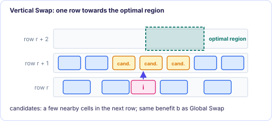
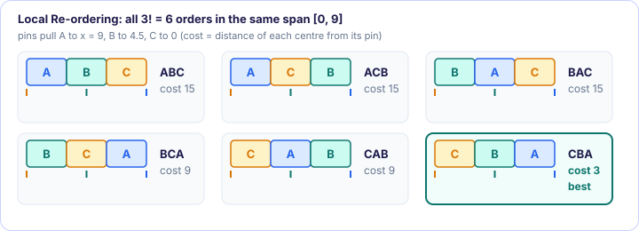

[← 2. The optimal region and Global Swap](02-global-swap.md) · [FastDP contents](README.md) · [4. Single-Segment Clustering →](04-single-segment-clustering.md)

# 3. Vertical Swap and Local Re-ordering

*In the paper: §III-B, §III-C.*

**Goal:** fix the small mistakes Global Swap leaves behind: cells one row away from where
they should be, and neighbours in the wrong order.

### 3.1 Why Global Swap misses some cells

Global Swap can fail to find a swap for a cell for two reasons:

1. **The region is full.** The cell is wide and its optimal region is crowded, so the
   segments crossing the region cannot take it.
2. **The penalty is too high.** Making room for the cell would shift many cells, and
   $P_1 + P_2$ eats the whole gain.

Such a cell stays where it is, even if a smaller step towards its optimal region would
help.

### 3.2 Vertical Swap

**Vertical Swap** takes that smaller step. If cell $i$'s optimal region is above (or
below) its current row, it considers **a few nearby cells in the row directly above (or
below)** as swap partners. It uses the same benefit as Global Swap,
$b = (W_1 - W_2) - P_1 - P_2$, and swaps with the best candidate if the benefit is
positive. A cell moves by **one row at a time**.

<figure class="kt-figure" markdown="span">
  
  <figcaption>Cell i's optimal region is two rows up; Vertical Swap only considers a few cells in the next row up.</figcaption>
</figure>

It differs from Global Swap in three ways:

- **Less greedy.** Global Swap jumps straight into the optimal region; Vertical Swap only
  moves one row towards it. That flexibility can unblock moves: once a cell has moved one
  row, a later Global Swap may find room for it, or for the cell it swapped with.
- **Much faster.** Each cell has only a handful of candidates, instead of everything in its
  optimal region.
- **Vertical only.** It improves vertical wirelength locally; horizontal mistakes are left
  to the next two techniques.

The authors observed that alternating Vertical Swap with Global Swap lowers the wirelength
faster than running Global Swap alone.

### 3.3 Local Re-ordering

Global Swap can also fix horizontal mistakes, but it is an expensive tool for a two-cell
problem. **Local Re-ordering** is a cheap one: for every window of $n$ consecutive cells in
a segment, try every left-to-right order of those cells and keep the one with the shortest
wirelength.

To keep it fast, the positions of the cells for each order are not optimized:

- the window's left edge stays where the first cell's left edge was, and its right edge
  stays where the last cell's right edge was;
- for each order, the cells are spread evenly inside that span.

Exact positions do not matter much here, because Single-Segment Clustering
([chapter 4](04-single-segment-clustering.md)) will place the cells optimally anyway.
Local Re-ordering only has to get the **order** right.

**Why $n = 3$.** A window of $n$ cells has $n!$ orders.

| $n$ | orders | verdict |
| --- | ---: | --- |
| 2 | 2 | only swaps neighbours: too constrained |
| 3 | 6 | the choice |
| 4 | 24 | 4 times slower, and the improvement is not significant |

A three-cell window in one row is very local, much smaller than the windows of classic
window-based detailed placers. That is fine because Global Swap handles the long moves;
Local Re-ordering is only there to fix local errors cheaply.

> [!TIP]
> **Example.** Cells A, B, C sit left to right in a window spanning $[0, 9]$, all width 3.
> Each is on one net to a fixed pin: A's pin is at $x = 9$, B's at 4.5, C's at 0. Every
> order puts the cells at 0, 3 and 6 (centres 1.5, 4.5, 7.5), and its cost is the sum of
> the distances from each centre to its pin. The original order ABC costs 15; CBA costs 3
> and wins.
<figure class="kt-figure" markdown="span">
  
  <figcaption>The six orders of the example and their costs.</figcaption>
</figure>

> [!IMPORTANT]
> **Key takeaways**
>
> - Vertical Swap moves a cell one row towards its optimal region, swapping with one of a few nearby cells, using Global Swap's benefit.
> - It is less greedy and much faster than Global Swap, and interleaving the two lowers wirelength faster.
> - Local Re-ordering tries all $n! = 6$ orders of every 3 consecutive cells, with the cells spread evenly over the window's span.
> - Exact positions are left to Single-Segment Clustering.

### Exercises

**1.** Why does Local Re-ordering not optimize the positions of the cells for each order?

Answer

Speed, and it is not needed: it only has to choose an order, and Single-Segment Clustering
later places the cells of each segment at their exact best positions for that order.

**2.** Why would $n = 4$ be 4 times slower than $n = 3$?

Answer

A window of $n$ cells has $n!$ orders to evaluate: $4! = 24$ against $3! = 6$, four times
as many.

---

[← 2. The optimal region and Global Swap](02-global-swap.md) · [FastDP contents](README.md) · [4. Single-Segment Clustering →](04-single-segment-clustering.md)
