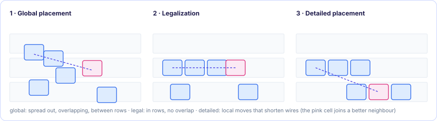
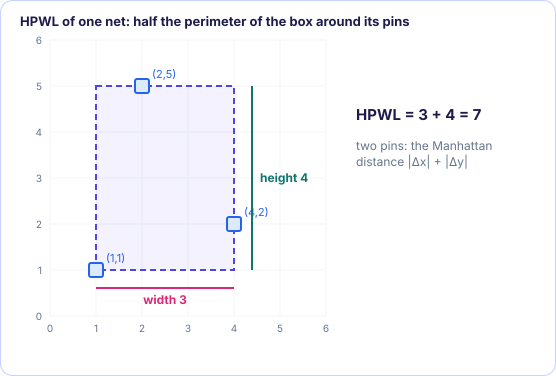

[Foundations contents](README.md) · [2. The math toolkit, gently →](02-math-toolkit.md)

# 1. The placement problem and wirelength

*In the SimPL paper: §1, §2.*

### 1.1 What is being placed

A chip design, at this stage, is a **netlist**:

- **Cells** (the paper also says *modules*, *nodes* or *components*): small rectangles
  such as NAND, NOR, MUX or flip-flops (*standard cells*), plus a few big blocks
  (*macros*). Each has a width and a height, so an area.
- **Nets**: wires. One net connects the output of one cell to the inputs of
  several others. A net that connects more than two cells is a **hyperedge**
  (an ordinary graph edge joins exactly two nodes; a hyperedge can join any
  number). The netlist is written $N = (E, V)$: $E$ the nets, $V$ the cells.

Some cells are **fixed**: their position is given and may not change (I/O pads
around the border, pre-placed macros). The rest are **movable**.

**Placement** chooses a location $(x_i, y_i)$ for every movable cell $i$ so that

1. the total wire is short, and
2. cells do not pile up: inside any rectangle of the chip, the area of the cells
   must not exceed the area available there.

In practice condition 2 is checked on a **bin grid**: the chip is cut into many
equal small rectangles (bins), and each bin may hold at most as much cell area as
it has free space (footnote *a* of the paper).

### 1.2 Global placement, legalization, detailed placement

Placement is done in three stages:

1. **Global placement** (what SimPL does): find good *approximate* locations.
   Small overlaps and cells not exactly aligned to the rows are tolerated.
2. **Legalization**: snap every cell into a legal row position with no overlap.
3. **Detailed placement**: small local improvements (swaps, shifts).

<figure class="kt-figure" markdown="span">
  
  <figcaption>Global placement spreads cells roughly; legalization snaps them into rows without overlap; detailed placement makes local moves that shorten wires.</figcaption>
</figure>

SimPL is a global placer. For stages 2 and 3 the authors use an existing tool
(FastPlace-DP).

### 1.3 Measuring wire: HPWL (Equation 1)

We cannot route the wires yet, so we estimate their length. For one net $e$, draw
the smallest axis-aligned box that contains all its pins. Half of the box's
perimeter is the net's **half-perimeter wirelength**:

$$
\mathrm{HPWL}(e) = \Big(\max_{i \in e} x_i - \min_{i \in e} x_i\Big) + \Big(\max_{i \in e} y_i - \min_{i \in e} y_i\Big)
$$

and for the whole netlist we add it up over all nets:

$$
\mathrm{HPWL}_N(\vec x, \vec y) = \sum_{e \in E} \mathrm{HPWL}(e) \qquad \text{(Eq. 1)}
$$

Here $\vec x = \{x_i\}$ means "the list of all x coordinates", likewise $\vec y$.

**Example.** A net with three pins at $(1,1)$, $(4,2)$, $(2,5)$:
width $= 4-1 = 3$, height $= 5-1 = 4$, HPWL $= 3 + 4 = 7$.

For a two-pin net, HPWL is just the **Manhattan (taxicab) distance**
$|x_1 - x_2| + |y_1 - y_2|$: the distance you walk on a city grid. Equation 1
generalizes it to many pins. HPWL is cheap to compute and is a surprisingly good
predictor of the final routed length, which is why every placement benchmark
reports it.

<figure class="kt-figure" markdown="span">
  
  <figcaption>The example net: its bounding box is 3 wide and 4 tall, so HPWL = 7.</figcaption>
</figure>

> [!WARNING]
> **The difficulty.** HPWL is built from `max`, `min` and absolute values. These
> have sharp corners (think of the graph of $|x|$, a V shape), and the fast
> optimization methods we want need *smooth* functions. So placers replace HPWL with
> a smooth stand-in. SimPL's stand-in is a **quadratic** (squared) function, which
> [Chapter 3](03-quadratic-placement.md) builds. First the tools.

> [!IMPORTANT]
> **Key takeaways**
>
> - A netlist is cells (rectangles) and nets (wires joining two or more cells); some cells are fixed in place.
> - Global placement finds approximate locations; legalization and detailed placement finish the job.
> - Wire is estimated by HPWL: half the perimeter of each net's bounding box, summed over all nets (Eq. 1).
> - HPWL has sharp corners (max, min), so placers optimize a smooth stand-in for it.

### Exercises

**1.** A net has pins at $(0,0)$, $(3,1)$ and $(1,4)$. What is its HPWL?

Answer

Width $3 - 0 = 3$, height $4 - 0 = 4$, so HPWL $= 3 + 4 = 7$.

**2.** Net A has pins at $(1,1)$ and $(4,1)$; net B has pins at $(2,0)$, $(2,5)$ and $(3,3)$. What is the total HPWL of the two nets?

Answer

Net A: width 3, height 0, so 3. Net B: width $3 - 2 = 1$, height $5 - 0 = 5$, so 6. Total $3 + 6 = 9$.

**3.** Why can't a placer simply minimize HPWL with a fast smooth method?

Answer

HPWL is built from $\max$, $\min$ and absolute values. For a two-pin net, $\lvert x_1 - x_2 \rvert$ has a corner at $x_1 = x_2$: its slope jumps from $-1$ to $+1$, so there is no derivative there, and fast methods need smooth functions.

---

[Foundations contents](README.md) · [2. The math toolkit, gently →](02-math-toolkit.md)
