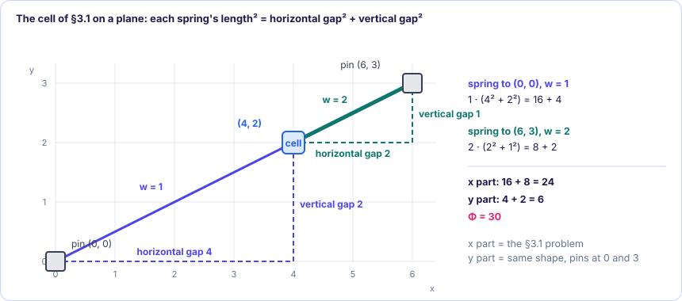
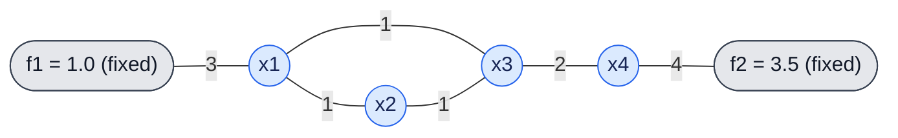
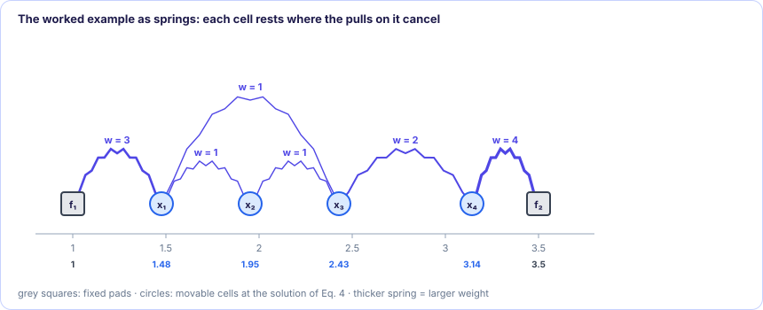
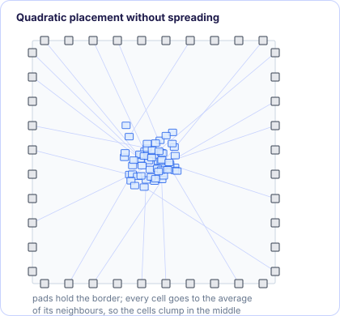

[← 2. The math toolkit, gently](02-math-toolkit.md) · [Foundations contents](README.md) · [4. Solving a million equations →](04-solving-linear-systems.md)

# 3. Quadratic placement

*In the SimPL paper: §2. The formulation is much older than SimPL: GORDIAN (1991)
and Kraftwerk2 (2008) place cells the same way ([References](../references.md)).*

This chapter derives every formula from one physical picture. Each step is shown
first on a single cell you can follow in your head, then on the paper's four-cell
example, then in general. Treat each cell as a point at its centre; real cell
sizes come back in legalization.

### 3.1 The spring picture

Imagine every wire as a **coil spring**. Fixed cells (pads, macros) are nails in
the board; movable cells are beads the springs can drag around. Let go, and the
beads slide until they stop. Where do they stop?

**Hooke's law.** A spring of stiffness $w$ stretched to length $d$ pulls on both
ends with force $w \cdot d$: twice as stretched, twice the pull.

**Energy.** The energy stored in the spring is the work it took to stretch it. The
force grows in a straight line from $0$ to $w d$ as the spring opens from $0$ to
$d$, so the work is the area of that triangle:

$$
E = \tfrac12 \cdot d \cdot (w d) = \tfrac12 w d^2
$$

That is where the **square** comes from: the energy of a spring grows with the
square of its length.

**A bead between two nails.** One movable cell at position $x$ is tied to a nail
at $0$ with stiffness $1$ and to a nail at $6$ with stiffness $2$.

- The left spring has length $x$ and pulls the cell left with force $1 \cdot x$.
- The right spring has length $6 - x$ and pulls it right with force $2 \cdot (6 - x)$.

The cell stops where the two pulls are equal:

$$
x = 2(6 - x) \;\Rightarrow\; 3x = 12 \;\Rightarrow\; x = 4
$$

Now look at the same thing through energy. The total energy is
$E(x) = \tfrac12\big[1\cdot x^2 + 2(6 - x)^2\big]$, and its slope is

$$
\frac{dE}{dx} = 1\cdot x - 2(6 - x) = (\text{left pull}) - (\text{right pull})
$$

The slope of the energy *is* the net force (with the sign flipped). So "the pulls
cancel" and "the energy is at its lowest point" are the same statement, and both
give $x = 4$. This is **force equilibrium**, and it is the whole idea of quadratic
placement: we never simulate the springs moving; we write down the energy and find
the point where its slope is zero.

Drag the cell below. The arrows are the two pulls, the curve is the energy, and the
two arrows have equal length exactly where the curve bottoms out.

### 3.2 The quadratic objective (Equation 2)

§3.1 had one cell on a line. A chip has thousands of cells on a plane, wired by
many springs. The paper's cost (Eq. 2) is just the §3.1 energy written for that
situation. We get there in three small steps.

#### Step 1: one spring on a plane

Cell 1 sits at $(1, 1)$ and cell 2 at $(4, 5)$, joined by a spring of stiffness
$w = 2$. The spring runs diagonally. Its length comes from Pythagoras: the
horizontal gap is $4 - 1 = 3$, the vertical gap is $5 - 1 = 4$, so

$$
\text{length}^2 = 3^2 + 4^2 = 25 \qquad (\text{length} = 5)
$$

The spring energy is stiffness × length², as in §3.1:
$2 \cdot 25 = 50$. Written with letters for any two cells $i$ and $j$ joined by a
spring of stiffness $w_{ij}$:

$$
\text{energy of one spring} = w_{ij}\Big[\underbrace{(x_i - x_j)^2}_{\text{horizontal gap}^2} + \underbrace{(y_i - y_j)^2}_{\text{vertical gap}^2}\Big]
$$

Check: $2\big[(1 - 4)^2 + (1 - 5)^2\big] = 2[9 + 16] = 50$ ✓. (The $\tfrac12$ of
§3.1 is dropped; see the note at the end of this section.)

#### Step 2: the cell of §3.1, now on a plane

Take the cell of §3.1 and give the two pins a height. The pin of stiffness 1 is at
$(0, 0)$, the pin of stiffness 2 at $(6, 3)$, and the movable cell is at an unknown
point $(x, y)$. By Step 1, each spring's energy is stiffness × (horizontal gap² +
vertical gap²):

$$
\Phi = 1\Big[(x - 0)^2 + (y - 0)^2\Big] + 2\Big[(x - 6)^2 + (y - 3)^2\Big]
$$

Now sort the four squares into the ones with $x$ and the ones with $y$:

$$
\Phi = \underbrace{1\cdot(x - 0)^2 + 2(x - 6)^2}_{\text{only } x} \;+\; \underbrace{1\cdot(y - 0)^2 + 2(y - 3)^2}_{\text{only } y}
$$

- The **$x$ part** is exactly the 1-D problem of §3.1: pins at 0 and 6, stiffness 1
  and 2. Its answer is $x = \frac{1\cdot 0 + 2\cdot 6}{1 + 2} = 4$.
- The **$y$ part** is the same kind of 1-D problem, with the pins at heights 0 and 3:
  $y = \frac{1\cdot 0 + 2\cdot 3}{1 + 2} = 2$.

So the cell goes to $(4, 2)$: the 2-D problem is two 1-D problems side by side,
one along the x-axis and one along the y-axis.

<figure class="kt-figure" markdown="span">
  
  <figcaption>Each spring's squared length is its horizontal gap² plus its vertical gap² (dashed triangles). The horizontal gaps make the x problem of §3.1, the vertical gaps a y problem of the same shape.</figcaption>
</figure>

**Check with forces.** A spring on a plane pulls along its own direction. Split
that pull into a horizontal and a vertical part: a spring of stiffness $w$ pulls
$w \times$ (horizontal gap) sideways and $w \times$ (vertical gap) up or down, like
two separate 1-D springs. At $(4, 2)$:

| Spring | Horizontal pull | Vertical pull |
| --- | ---: | ---: |
| to $(0, 0)$, stiffness 1 | $1 \cdot (0 - 4) = -4$ (left) | $1 \cdot (0 - 2) = -2$ (down) |
| to $(6, 3)$, stiffness 2 | $2 \cdot (6 - 4) = +4$ (right) | $2 \cdot (3 - 2) = +2$ (up) |
| **Sum** | $0$ | $0$ |

Both sums are zero, so the cell is at rest. Notice that the horizontal pulls use
only x's and the vertical pulls only y's. That is why the two directions never
interfere, and why [§3.3](#33-x-and-y-separate) can solve them separately.

**Check with energy.** At $(4, 2)$:
$\Phi = \underbrace{16 + 8}_{x\text{ part}} + \underbrace{4 + 2}_{y\text{ part}} = 30$.
Move the cell one unit right to $(5, 2)$ and only the $x$ part changes: $25 + 2 = 27$,
so $\Phi = 33$. Move it one unit up to $(4, 3)$ and only the $y$ part changes:
$9 + 0 = 9$, so $\Phi = 33$. Every move away from $(4, 2)$ costs more.

#### Step 3: many springs, add them up

The total energy is the energy of every spring added together. Add a cell 3 at
$(4, 2)$, tied to cell 2 by a spring of stiffness 1. Now there are two springs:

| Spring | Stiffness | Horizontal gap² | Vertical gap² | Energy |
| --- | ---: | ---: | ---: | ---: |
| 1–2 | 2 | $(1 - 4)^2 = 9$ | $(1 - 5)^2 = 16$ | $2 \cdot 25 = 50$ |
| 2–3 | 1 | $(4 - 4)^2 = 0$ | $(5 - 2)^2 = 9$ | $1 \cdot 9 = 9$ |
| | | | **Total** | **59** |

As one formula, one bracket per spring:

$$
\Phi = 2\Big[(x_1 - x_2)^2 + (y_1 - y_2)^2\Big] + 1\Big[(x_2 - x_3)^2 + (y_2 - y_3)^2\Big]
$$

A real chip has millions of springs, too many to write out, so we write "add this
up over every spring" with the $\sum$ sign instead.

#### Step 4: name the springs, and read Eq. 2

The list of springs is a **graph**: the cells are its points ($V$), and each spring
is an *edge* $e_{ij}$ between cells $i$ and $j$ with a weight $w_{ij} > 0$, its
stiffness. The set of all edges is $E_G$. In Step 3, $E_G = \{e_{12}, e_{23}\}$ with
$w_{12} = 2$ and $w_{23} = 1$. Where the edges come from: a wire (net) joining two
cells is one edge; how a net joining more cells becomes several edges, and how the
weights are chosen, is [Chapter 5](05-net-models.md). For now the edges and weights
are simply given.

Now Step 3's formula, for any graph, is the paper's Eq. 2:

$$
\Phi_G(\vec x, \vec y) = \sum_{e_{ij} \in E_G} w_{ij}\Big[(x_i - x_j)^2 + (y_i - y_j)^2\Big] \qquad \text{(Eq. 2)}
$$

Read it piece by piece:

| Symbol | Meaning | In Step 3 |
| --- | --- | --- |
| $\Phi_G$ | the total spring energy of graph $G$: the cost to make small | 59 |
| $(\vec x, \vec y)$ | it depends on every cell's position: $\vec x$ lists all x's, $\vec y$ all y's | $\vec x = [1, 4, 4]$, $\vec y = [1, 5, 2]$ |
| $\sum_{e_{ij} \in E_G}$ | "for every edge $e_{ij}$ in the graph, add up…" | two edges: 1–2 and 2–3 |
| $w_{ij}$ | that edge's stiffness | 2, then 1 |
| $\big[(x_i - x_j)^2 + (y_i - y_j)^2\big]$ | that edge's length², by Pythagoras | 25, then 9 |

So Eq. 2 says nothing new: **the cost is the energy of all the springs, each one
stiffness × length², exactly as for the single cell of §3.1.** Placing the cells
means choosing $\vec x$ and $\vec y$ to make this number as small as possible.

Two notes:

- Some cells are fixed (pads, macros). Their positions in Eq. 2 are known numbers,
  not unknowns: they are the nails. Only the movable cells' coordinates are chosen.
- The $\tfrac12$ from Hooke's law is gone. Multiplying the whole cost by a positive
  number makes every value bigger but does not move the lowest point, so placers
  drop constants freely. You will see factors of $\tfrac12$ and $2$ come and go;
  none of them changes the answer.

**Why squares and not plain distances?** The real goal is short wires, so the
obvious cost would be the length itself, $w|x_i - x_j|$. Compare the two on the
bead of §3.1:

| $x$ | 0 | 2 | 3 | 4 | 6 |
| --- | ---: | ---: | ---: | ---: | ---: |
| length cost $1\cdot\lvert x\rvert + 2\cdot\lvert x - 6\rvert$ | 12 | 10 | 9 | 8 | **6** |
| squared cost $1\cdot x^2 + 2(x - 6)^2$ | 72 | 36 | 27 | **24** | 36 |

- The length cost is a set of straight pieces with a corner at each pin. Its slope
  jumps from one value to another, so "set the slope to zero" has no equation to
  solve. Here it pushes the cell all the way onto the stiffer pin. With equal
  weights, $|x| + |x - 6| = 6$ for *every* $x$ between the pins: no single answer at
  all.
- The squared cost is a smooth bowl. Its slope is a straight line,
  $2x + 4(x - 6) = 6x - 24$, so setting it to zero is a **linear** equation
  ($6x = 24$). With a million cells this becomes a million linear equations, which
  [Chapter 4](04-solving-linear-systems.md) solves quickly. Nothing else of that size
  is as easy to solve.

**The price.** Squares exaggerate long wires: one wire of length 10 costs $100$,
while ten wires of length 1 cost $10$, although both add up to 10 units of wire.
So a pure quadratic placer shortens long wires too eagerly. SimPL fixes this by
choosing each weight as $1/\text{length}$, so that $w\,\ell^2 = \ell$: the squared
cost then measures plain length at the current placement
([Chapter 5](05-net-models.md)).

### 3.3 x and y separate

Expand Eq. 2:

$$
\Phi_G = \underbrace{\sum w_{ij}(x_i - x_j)^2}_{\Phi_x \text{ (only x's)}} + \underbrace{\sum w_{ij}(y_i - y_j)^2}_{\Phi_y \text{ (only y's)}}
$$

No term mixes an $x$ with a $y$: moving a cell up or down changes $\Phi_y$ and
leaves $\Phi_x$ exactly as it was. In the Step 3 example of §3.2, the
horizontal-gap column gives $\Phi_x = 2\cdot9 + 1\cdot0 = 18$ and the vertical-gap
column gives $\Phi_y = 2\cdot16 + 1\cdot9 = 41$; $18 + 41 = 59$. Moving cell 3 up
changes only the second number. So minimizing $\Phi_G$ is two independent
problems: minimize $\Phi_x$ over the x's, and minimize $\Phi_y$ over the y's. The
paper calls this *separable*; from now on we only treat $x$, and $y$ is identical.
(It also means the two can be solved at the same time on two CPU cores, [SimPL §4.3](../global-placement/simpl/04-speed-results-parallelism.md#43-parallelism).)

### 3.4 Matrix form (Equation 3)

The paper packs $\Phi_x$ into one line,

$$
\Phi_x(\vec x) = \tfrac12\,\vec x^T Q_x \vec x + \vec c_x^{\,T}\vec x + \text{const} \qquad \text{(Eq. 3)}
$$

and states the minimum without derivation. This section builds that line one edge
at a time. Only two kinds of edges exist, and each is expanded with
$(a - b)^2 = a^2 - 2ab + b^2$.

#### Step A: one edge between two movable cells

$$
w(x_i - x_j)^2 = w\,x_i^2 \;-\; 2w\,x_ix_j \;+\; w\,x_j^2
$$

[§2.4](02-math-toolkit.md#24-the-quadratic-form-vec-xt-q-vec-x-a-sum-of-squares-in-disguise)
showed that a 2×2 table $\begin{bmatrix} a & b\\ b & c \end{bmatrix}$ gives
$a x_1^2 + 2b\,x_1x_2 + c x_2^2$. Match the terms: $a = w$, $b = -w$, $c = w$. So
this edge is the table

$$
w(x_i - x_j)^2 = \begin{bmatrix} x_i & x_j \end{bmatrix}
\begin{bmatrix} w & -w\\ -w & w \end{bmatrix}
\begin{bmatrix} x_i\\ x_j \end{bmatrix}
$$

Call this little table the edge's **stamp**: $+w$ on the two diagonal places
$(i,i)$ and $(j,j)$, and $-w$ on the two places $(i,j)$ and $(j,i)$ that link them.

#### Step B: one edge from a movable cell to a fixed cell

The fixed cell sits at a known number $x_f$, so it is not an unknown:

$$
w(x_i - x_f)^2 = \underbrace{w\,x_i^2}_{\text{diagonal } +w} \;\underbrace{-\; 2\,(w x_f)\,x_i}_{\text{linear term}} \;+\; \underbrace{w\,x_f^2}_{\text{constant}}
$$

This edge stamps only $+w$ on the diagonal place $(i,i)$. Its middle term is a
number times $x_i$; collect those numbers in a list $\vec b$ by adding $w x_f$ to
$b_i$. The last term contains no unknown at all: it is the same for every
placement, so it cannot affect where the minimum is, and it goes into "const".

#### Step C: add up all the edges

$\Phi_x$ is the sum of all its edge terms, and adding the terms means adding the
stamps entry by entry into one big table $Q$:

$$
\Phi_x(\vec x) = \vec x^T Q\, \vec x \;-\; 2\,\vec b^T \vec x \;+\; \text{const}
$$

Reading off what each entry collects gives the rules:

| Entry | Value | Comes from |
| --- | --- | --- |
| $Q_{ii}$ (diagonal) | sum of the weights of **all** edges touching movable cell $i$ | every edge at $i$ stamps $+w$ there (Steps A and B) |
| $Q_{ij}$, $i \ne j$ (off-diagonal) | $-$(sum of the weights of edges between movable $i$ and movable $j$) | Step A stamps; several nets between the same pair add up |
| $b_i$ | sum over fixed cells $f$ connected to $i$ of $w_{if}\cdot x_f$ | Step B's linear terms |

For the bead of §3.1, $\Phi = 1\cdot x^2 + 2(x - 6)^2 = 3x^2 - 24x + 72$. The
rules give $Q = [\,1 + 2\,] = [3]$ and $b = 2 \cdot 6 = 12$, and indeed
$3x^2 - 2\cdot 12\,x + 72$ is the same polynomial.

#### Step D: set every slope to zero

At the minimum, the partial derivative with respect to every $x_i$ is zero
([§2.5](02-math-toolkit.md#25-derivatives-with-many-variables)). Differentiate
$\Phi_x$ edge by edge with $\frac{d}{dx}w(x - c)^2 = 2w(x - c)$, keeping only the
edges that touch cell $i$:

$$
\frac{\partial\Phi_x}{\partial x_i}
= \sum_{\text{movable } j} 2w_{ij}(x_i - x_j) \;+\; \sum_{\text{fixed } f} 2w_{if}(x_i - x_f)
$$

Multiply out and group by unknown:

$$
\frac{\partial\Phi_x}{\partial x_i}
= 2\Big[\underbrace{\Big(\sum_{\text{all}} w\Big)}_{Q_{ii}} x_i
\;+\; \sum_{\text{movable } j} \underbrace{(-w_{ij})}_{Q_{ij}}\, x_j
\;-\; \underbrace{\sum_{\text{fixed } f} w_{if}\,x_f}_{b_i}\Big]
= 2\big[(Q\vec x)_i - b_i\big]
$$

The bracket is row $i$ of $Q$ times $\vec x$, minus $b_i$
([§2.3](02-math-toolkit.md#23-matrices-a-table-that-turns-a-list-into-another-list)).
Setting it to zero for every $i$ at once gives one equation per movable cell, which
together are

$$
\boxed{\,Q\vec x = \vec b\,}
$$

For the bead: $3x = 12$, so $x = 4$, as in §3.1.

#### Matching the paper's symbols

Rewrite Step C as $\tfrac12\,\vec x^T(2Q)\,\vec x + (-2\vec b)^T\vec x + \text{const}$.
That is Eq. 3 with $Q_x = 2Q$ and $\vec c_x = -2\vec b$. The paper's condition for the
minimum, $Q_x\vec x = -\vec c_x$, is $2Q\vec x = 2\vec b$: the same equations, both
sides doubled. The paper keeps the $\tfrac12$ so that $Q_x$ is exactly the table of
second derivatives (the *Hessian* of [§2.5](02-math-toolkit.md#25-derivatives-with-many-variables)).
This guide uses $Q$ and $\vec b$ because their entries are the plain edge weights.

- $Q$ records **movable–movable** connections (and, on its diagonal, every
  connection).
- $\vec b$ records **movable–fixed** connections: where the nails are and how hard
  they pull.

### 3.5 The worked example (Figure 1 and Equation 4)

Figure 1 of the paper has four movable cells $x_1..x_4$ and two fixed cells at
$f_1 = 1.0$, $f_2 = 3.5$, with six edges whose weights are 1, 1, 1, 2, 3 and 4.
The figure is a drawing and its exact wiring is hard to read from the text; the
graph below uses exactly those weights and reproduces the paper's stated answer
exactly, so it is the right system to learn from:

Edges: $f_1$–$x_1$ (3), $x_1$–$x_2$ (1), $x_1$–$x_3$ (1), $x_2$–$x_3$ (1),
$x_3$–$x_4$ (2), $x_4$–$f_2$ (4).

There are two ways to get the equations, and they must agree: by calculus
(Steps 1 and 2) and by stamping (Step 3).

**Step 1: write the cost.** One term per edge (Eq. 2, x part):

$$
\Phi = 3(x_1 - 1)^2 + (x_1 - x_2)^2 + (x_1 - x_3)^2 + (x_2 - x_3)^2 + 2(x_3 - x_4)^2 + 4(x_4 - 3.5)^2
$$

**Step 2: take each partial derivative and set it to zero.** Use the rule
$\frac{d}{dx}w(x-c)^2 = 2w(x-c)$. For $x_1$, only terms containing $x_1$ matter:

$$
\frac{\partial\Phi}{\partial x_1} = 2\cdot3(x_1 - 1) + 2(x_1 - x_2) + 2(x_1 - x_3) = 0
$$

Divide by 2 and collect: $3x_1 - 3 + x_1 - x_2 + x_1 - x_3 = 0$, i.e.

$$
5x_1 - x_2 - x_3 = 3
$$

For $x_2$ (it appears as the *second* variable in $(x_1-x_2)^2$, whose derivative
with respect to $x_2$ is $-2(x_1 - x_2)$):

$$
\frac{\partial\Phi}{\partial x_2} = -2(x_1 - x_2) + 2(x_2 - x_3) = 0 \;\Rightarrow\; -x_1 + 2x_2 - x_3 = 0
$$

For $x_3$:

$$
\frac{\partial\Phi}{\partial x_3} = -2(x_1 - x_3) - 2(x_2 - x_3) + 2\cdot2(x_3 - x_4) = 0 \;\Rightarrow\; -x_1 - x_2 + 4x_3 - 2x_4 = 0
$$

For $x_4$:

$$
\frac{\partial\Phi}{\partial x_4} = -2\cdot2(x_3 - x_4) + 2\cdot4(x_4 - 3.5) = 0 \;\Rightarrow\; -2x_3 + 6x_4 = 14
$$

These four equations are Eq. 4, the system from [§2.3](02-math-toolkit.md#23-matrices-a-table-that-turns-a-list-into-another-list):

$$
\begin{bmatrix} 5 & -1 & -1 & 0\\ -1 & 2 & -1 & 0\\ -1 & -1 & 4 & -2\\ 0 & 0 & -2 & 6 \end{bmatrix}
\begin{bmatrix} x_1\\ x_2\\ x_3\\ x_4 \end{bmatrix}
=
\begin{bmatrix} 3\\ 0\\ 0\\ 14 \end{bmatrix}
\qquad \text{(Eq. 4)}
$$

**Step 3: the same system by stamping.** Start from an empty table and add the six
edges one at a time with the rules of [§3.4](#34-matrix-form-equation-3). This is
how a placer actually builds $Q$: it never differentiates anything, it walks the
edge list and adds stamps.

=== "Edge 1: f₁–x₁ (3)"

    Movable–fixed: $+3$ on $Q_{11}$, and $3 \cdot f_1 = 3$ into $b_1$.

    $$
    Q = \begin{bmatrix} \mathbf{3} & 0 & 0 & 0\\ 0 & 0 & 0 & 0\\ 0 & 0 & 0 & 0\\ 0 & 0 & 0 & 0 \end{bmatrix}
    \qquad
    \vec b = \begin{bmatrix} \mathbf{3}\\ 0\\ 0\\ 0 \end{bmatrix}
    $$

=== "Edge 2: x₁–x₂ (1)"

    Movable–movable: $+1$ on $Q_{11}$ and $Q_{22}$, $-1$ on $Q_{12}$ and $Q_{21}$.

    $$
    Q = \begin{bmatrix} \mathbf{4} & \mathbf{-1} & 0 & 0\\ \mathbf{-1} & \mathbf{1} & 0 & 0\\ 0 & 0 & 0 & 0\\ 0 & 0 & 0 & 0 \end{bmatrix}
    \qquad
    \vec b = \begin{bmatrix} 3\\ 0\\ 0\\ 0 \end{bmatrix}
    $$

=== "Edge 3: x₁–x₃ (1)"

    $+1$ on $Q_{11}$ and $Q_{33}$, $-1$ on $Q_{13}$ and $Q_{31}$.

    $$
    Q = \begin{bmatrix} \mathbf{5} & -1 & \mathbf{-1} & 0\\ -1 & 1 & 0 & 0\\ \mathbf{-1} & 0 & \mathbf{1} & 0\\ 0 & 0 & 0 & 0 \end{bmatrix}
    \qquad
    \vec b = \begin{bmatrix} 3\\ 0\\ 0\\ 0 \end{bmatrix}
    $$

=== "Edge 4: x₂–x₃ (1)"

    $+1$ on $Q_{22}$ and $Q_{33}$, $-1$ on $Q_{23}$ and $Q_{32}$.

    $$
    Q = \begin{bmatrix} 5 & -1 & -1 & 0\\ -1 & \mathbf{2} & \mathbf{-1} & 0\\ -1 & \mathbf{-1} & \mathbf{2} & 0\\ 0 & 0 & 0 & 0 \end{bmatrix}
    \qquad
    \vec b = \begin{bmatrix} 3\\ 0\\ 0\\ 0 \end{bmatrix}
    $$

=== "Edge 5: x₃–x₄ (2)"

    $+2$ on $Q_{33}$ and $Q_{44}$, $-2$ on $Q_{34}$ and $Q_{43}$.

    $$
    Q = \begin{bmatrix} 5 & -1 & -1 & 0\\ -1 & 2 & -1 & 0\\ -1 & -1 & \mathbf{4} & \mathbf{-2}\\ 0 & 0 & \mathbf{-2} & \mathbf{2} \end{bmatrix}
    \qquad
    \vec b = \begin{bmatrix} 3\\ 0\\ 0\\ 0 \end{bmatrix}
    $$

=== "Edge 6: x₄–f₂ (4)"

    Movable–fixed: $+4$ on $Q_{44}$, and $4 \cdot f_2 = 14$ into $b_4$. This is
    Eq. 4.

    $$
    Q = \begin{bmatrix} 5 & -1 & -1 & 0\\ -1 & 2 & -1 & 0\\ -1 & -1 & 4 & -2\\ 0 & 0 & -2 & \mathbf{6} \end{bmatrix}
    \qquad
    \vec b = \begin{bmatrix} 3\\ 0\\ 0\\ \mathbf{14} \end{bmatrix}
    $$

Or build it yourself. Point at an edge to see which entries its stamp touches;
click it to take it out of the graph and watch those entries change. Remove both
edges to the fixed cells, $f_1$–$x_1$ and $x_4$–$f_2$, and $\vec b$ becomes all
zeros: nothing ties the cells down any more, and the bowl loses its single bottom
(§3.7).

The result is the same table as Step 2, and it obeys the rules:

- $Q_{11} = 5 = 3 + 1 + 1$, the sum of the weights at $x_1$. $Q_{44} = 6 = 2 + 4$.
- $Q_{34} = Q_{43} = -2$, minus the $x_3$–$x_4$ weight. The matrix is symmetric
  because the spring between 3 and 4 is the same spring seen from either end.
- $b_1 = 3 \cdot f_1 = 3\cdot1.0 = 3$; $b_4 = 4 \cdot f_2 = 4\cdot 3.5 = 14$;
  $x_2, x_3$ touch no fixed cell, so $b_2 = b_3 = 0$.

**Step 4: solve by hand.** Substitution is fine for 4 unknowns; open the steps if
you want to follow them, or skip to the result.

Show the substitution steps

- Row 2: $x_2 = (x_1 + x_3)/2$.
- Row 4: $x_4 = (14 + 2x_3)/6 = (7 + x_3)/3$.
- Row 1 with $x_2$ substituted: $5x_1 - \frac{x_1 + x_3}{2} - x_3 = 3$. Multiply by
  2: $9x_1 - 3x_3 = 6$, so $x_1 = (2 + x_3)/3$.
- Row 3 with $x_2$ and $x_4$ substituted, multiplied by 6:
  $-9x_1 + 17x_3 = 28$. Put in $x_1$: $-3(2 + x_3) + 17x_3 = 28$, so $14x_3 = 34$.

$$
x_3 = \tfrac{17}{7} \approx 2.4286,\quad x_1 = \tfrac{31}{21} \approx 1.4762,\quad x_2 = \tfrac{41}{21} \approx 1.9524,\quad x_4 = \tfrac{22}{7} \approx 3.1429
$$

which is the paper's $\vec x = [1.4762\ \ 1.9524\ \ 2.4286\ \ 3.1429]^T$.

**Step 5: check it with forces.** At the answer, every cell's pulls must cancel.
Take $x_4 \approx 3.1429$: the spring to $x_3$ pulls it left with
$2 \cdot (3.1429 - 2.4286) = 1.4286$, the spring to $f_2$ pulls it right with
$4 \cdot (3.5 - 3.1429) = 1.4286$. Equal, so $x_4$ is at rest.

<figure class="kt-figure" markdown="span">
  
  <figcaption>The solution of Eq. 4 drawn on the x-axis: every movable cell sits between the cells its springs pull it towards, closer to the stiffer ones.</figcaption>
</figure>

**Try it yourself.** Below is the same network, live. Press *Scramble the cells* and
watch every cell slide toward the weighted average of its neighbours until the red
net-force arrows vanish. The positions it settles on are the "exact solution" column,
the solution of $Q\vec x = \vec b$. Click a spring to make it stiffer (that changes
one stamp of §3.4), or drag $f_1$ or $f_2$ (that changes $\vec b$), and the cells
find the new balance.

### 3.6 Every cell sits at the weighted average of its neighbours

Go back to Step D of [§3.4](#34-matrix-form-equation-3), before the matrix
appeared. Setting $\partial\Phi_x/\partial x_i = 0$ and dividing by 2 says

$$
\sum_{\text{neighbours } j} w_{ij}(x_i - x_j) = 0
$$

where the neighbours are all cells wired to $i$, movable or fixed. Each term
$w_{ij}(x_j - x_i)$ is the pull of one spring (positive if it pulls right), so this
is "the pulls add up to zero". Move the $x_i$ terms to one side:

$$
x_i \sum_j w_{ij} = \sum_j w_{ij}\,x_j
\qquad\Longrightarrow\qquad
x_i = \frac{\sum_j w_{ij}\,x_j}{\sum_j w_{ij}}
$$

In the example, row 2 says $x_2 = \frac{1\cdot x_1 + 1\cdot x_3}{1 + 1}$, and row 1 says
$x_1 = \frac{3\cdot f_1 + 1\cdot x_2 + 1\cdot x_3}{3 + 1 + 1}$. Check row 1 with the
numbers: $\frac{3 + 1.9524 + 2.4286}{5} = 1.4762$ ✓.

> [!IMPORTANT]
> **Each cell sits at the weighted average of the cells it connects to**, over all
> its neighbours $j$, movable or fixed. This is force equilibrium: a stiffer spring pulls
> the average harder toward its end. Keep this picture; the Jacobi method ([§4.2](04-solving-linear-systems.md#42-the-simplest-idea-jacobi-iteration)) and
> the anchors ([SimPL chapter 3](../global-placement/simpl/03-anchors-and-convergence.md)) are both easy to understand with it.

Note the catch hiding in this formula: each cell's position depends on its
neighbours' positions, which depend on *their* neighbours. That is why the cells
cannot be placed one at a time and the whole system has to be solved together.

### 3.7 Why $Q$ is a strictly convex bowl (SPD), and diagonal dominance

**The identity.** Add up the stamps of [§3.4](#34-matrix-form-equation-3) without the
$\vec b$ and constant parts. Each movable–movable edge contributes
$w(x_i - x_j)^2$ (Step A) and each movable–fixed edge contributes only its
diagonal part $w\,x_i^2$ (Step B). So

$$
\vec x^T Q \vec x = \sum_{\text{movable–movable edges}} w_{ij}(x_i - x_j)^2 \;+\; \sum_{\text{movable–fixed edges}} w_{if}\,x_i^2
$$

In words: $\vec x^TQ\vec x$ is the spring energy you would get if every fixed cell
were moved to position 0.

(Try it on the example. The $x_1$–$x_2$ edge (weight 1) puts $+1$ into $Q_{11}$ and
$Q_{22}$ and $-1$ into $Q_{12}$ and $Q_{21}$. In $\sum_i\sum_j x_iQ_{ij}x_j$ those four
entries give $x_1^2 + x_2^2 - x_1x_2 - x_2x_1 = (x_1 - x_2)^2$. The $f_1$–$x_1$ edge
(weight 3) only puts $+3$ into $Q_{11}$, which gives $3x_1^2$.)

**It is never negative.** Every term is $\ge 0$, so $\vec x^T Q\vec x \ge 0$. It is
$0$ only if every connected pair has equal coordinates *and* every cell attached to
a fixed cell is at 0. As long as every connected group of cells touches at least
one fixed cell, that forces every coordinate to 0. So $\vec x^TQ\vec x > 0$ for
every $\vec x$ that is not all zeros: $Q$ is SPD
([§2.6](02-math-toolkit.md#26-bowls-why-there-is-exactly-one-best-answer)).

**Why that means one bottom.** Let $\vec x^*$ solve $Q\vec x^* = \vec b$, and move
away from it by any step $\vec d$. Put $\vec x^* + \vec d$ into
$\Phi_x = \vec x^TQ\vec x - 2\vec b^T\vec x + \text{const}$ and multiply out (the
two cross terms $\vec d^TQ\vec x^*$ and $\vec x^{*T}Q\vec d$ are equal because $Q$ is
symmetric):

$$
\Phi_x(\vec x^* + \vec d) = \Phi_x(\vec x^*) + 2\,\vec d^T\underbrace{(Q\vec x^* - \vec b)}_{=\,0} + \vec d^TQ\vec d
= \Phi_x(\vec x^*) + \vec d^TQ\vec d
$$

Any step away from $\vec x^*$ costs exactly $\vec d^TQ\vec d$, which is positive
for every non-zero step. So $\vec x^*$ is the one and only lowest point. Check on
the bead of §3.1, where $Q = [3]$, $x^* = 4$ and $\Phi(4) = 24$: a step of $d = 1$
gives $\Phi(5) = 24 + 3\cdot1^2 = 27$, and $d = 2$ gives $\Phi(6) = 24 + 3\cdot 4 = 36$,
matching the table in §3.2.

If some group of cells had **no** connection to anything fixed, the whole group
could slide left or right without changing any spring length: a step $\vec d$ that
moves the whole group by the same amount has $\vec d^TQ\vec d = 0$. The bowl would
have a flat direction, $Q$ would be *degenerate* (singular), and there would be no
unique answer. That is the paper's "when $Q_x$ is nondegenerate".

**Diagonal dominance.** A matrix is *diagonally dominant* if in every row the
diagonal entry is at least the sum of the sizes of the other entries:
$Q_{ii} \ge \sum_{j\ne i}|Q_{ij}|$. In the example: $5 \ge 1+1$, $2 \ge 1+1$,
$4 \ge 1+1+2$, $6 \ge 2$. It always holds for placement matrices, and the stamps
show why: a movable–movable edge adds the same $w$ to the diagonal and to the
off-diagonal sizes, so it keeps the row balanced, while a movable–fixed edge adds
$w$ to the diagonal only. The surplus $Q_{ii} - \sum_{j\ne i}|Q_{ij}|$ is exactly
the weight from cell $i$ to fixed cells. The more surplus, the "rounder" the bowl
and the faster the solvers of [Chapter 4](04-solving-linear-systems.md) converge.
SimPL deliberately adds surplus ([SimPL chapter 3](../global-placement/simpl/03-anchors-and-convergence.md)).

### 3.8 The catch: everything collapses

> [!WARNING]
> Because every cell goes to the average of its neighbours, and the only things
> holding the netlist open are the fixed pads around the border, the solution of
> $Q\vec x = \vec b$ pulls almost all cells into a dense clump near the middle of the
> chip. Wirelength is wonderful; overlap is enormous. Every quadratic placer must add
> something that **spreads** cells out.

<figure class="kt-figure" markdown="span">
  
  <figcaption>Without spreading, the pads hold the border and everything else is pulled into a clump in the middle.</figcaption>
</figure>

Watch it happen. Forty movable cells start scattered over the chip, wired to each
other and to a few of the twelve pads. Each step moves every cell to the average of
its neighbours (§3.6). The squared wirelength falls at every step, and the cells
crowd together: nothing in $Q\vec x = \vec b$ knows that two cells cannot sit on
the same spot.

The two classic questions (paper §3) are:

1. **Direction:** which way should each cell be pushed?
2. **Force modulation:** how hard? Too weak and nothing spreads, too strong and
   the wirelength is destroyed or the iterations oscillate.

SimPL's answer to both is look-ahead legalization plus anchors; the [SimPL guide](../global-placement/simpl/README.md) explains both.

> [!IMPORTANT]
> **Key takeaways**
>
> - Wires are springs: a spring's energy grows with its length squared, so the cost is $\sum w_{ij}(x_i - x_j)^2$, solved separately in x and y.
> - Zero slope of the energy is zero net force on every cell.
> - Each edge stamps $+w$ on the diagonal of its movable ends and $-w$ between them; an edge to a fixed cell also adds $w\,x_f$ to $\vec b$. Setting the derivatives to zero gives $Q\vec x = \vec b$.
> - Every cell ends up at the weighted average of its neighbours.
> - The answer is unique when every group of cells touches something fixed, but the cells collapse into a clump, so something must spread them.

### Exercises

**1.** One movable cell is wired to fixed pins at 0 (weight 1), 6 (weight 2) and 9 (weight 3). Where does it go? Check that the pulls cancel there.

Answer

The weighted average: $x = \frac{1\cdot0 + 2\cdot6 + 3\cdot9}{1 + 2 + 3} = \frac{39}{6} = 6.5$. Pulls: left $1\cdot6.5 + 2\cdot0.5 = 7.5$, right $3\cdot2.5 = 7.5$ ✓.

**2.** Cell $x_1$ is wired to a fixed pin at 0 (weight 1) and to cell $x_2$ (weight 1); $x_2$ is also wired to a fixed pin at 9 (weight 2). Build $Q$ and $\vec b$ by stamping and solve.

Answer

Pin–$x_1$ stamps $+1$ on $Q_{11}$ and adds $1\cdot0 = 0$ to $b_1$. $x_1$–$x_2$ stamps $+1$ on $Q_{11}$ and $Q_{22}$ and $-1$ on $Q_{12}$, $Q_{21}$. $x_2$–pin stamps $+2$ on $Q_{22}$ and adds $2\cdot9 = 18$ to $b_2$. So $Q = \begin{bmatrix} 2 & -1\\ -1 & 3 \end{bmatrix}$, $\vec b = \begin{bmatrix} 0\\ 18 \end{bmatrix}$. From row 1, $x_2 = 2x_1$; then $5x_1 = 18$, so $x_1 = 3.6$ and $x_2 = 7.2$. Check: $x_1 = (0 + 7.2)/2$ and $x_2 = (3.6 + 2\cdot9)/3$.

**3.** In the worked example of §3.5, add a second net between $x_1$ and $x_2$ with weight 2. Which entries of Eq. 4 change, and to what?

Answer

The new edge stamps $+2$ on $Q_{11}$ and $Q_{22}$ and $-2$ on $Q_{12}$ and $Q_{21}$: $Q_{11} = 7$, $Q_{22} = 4$, $Q_{12} = Q_{21} = -1 - 2 = -3$. Nothing else changes, and $\vec b$ stays the same because the edge touches no fixed cell.

**4.** Two movable cells are wired only to each other, with weight 1. What goes wrong?

Answer

$Q = \begin{bmatrix} 1 & -1\\ -1 & 1 \end{bmatrix}$ and $\vec b = \vec 0$: every placement with $x_1 = x_2$ has zero cost, so there is a flat trough instead of a single bottom. In §3.7's terms, the step $\vec d = [1, 1]$ has $\vec d^TQ\vec d = 0$. $Q$ is degenerate (its rows add up to zero) and there is no unique answer.

---

[← 2. The math toolkit, gently](02-math-toolkit.md) · [Foundations contents](README.md) · [4. Solving a million equations →](04-solving-linear-systems.md)
