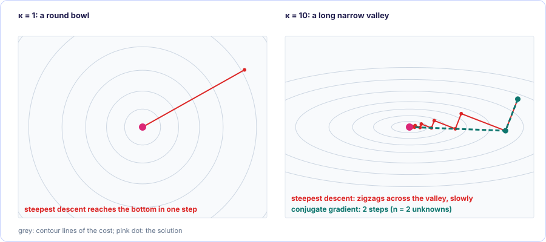

[← 3. Quadratic placement](03-quadratic-placement.md) · [Foundations contents](README.md) · [5. Net models: clique, star and Bound2Bound →](05-net-models.md)

# 4. Solving a million equations

*In the SimPL paper: §2.*

### 4.1 Why not just eliminate like in [§3.5](03-quadratic-placement.md#35-the-worked-example-figure-1-and-equation-4)

Elimination on $n$ unknowns costs about $n^3$ steps, and it also fills the sparse
matrix with nonzeros. For $n = 10^6$ that is $10^{18}$ steps. Instead we use
**iterative** methods: start from a guess and improve it, using only
matrix-times-vector products, which for a sparse matrix cost only "number of
nonzeros" steps.

How wrong is a guess $\vec x$? Measure the **residual**

$$
\vec r = \vec b - Q\vec x
$$

At the true solution $\vec r = 0$. And $\vec r$ is exactly the downhill direction:
with $\Phi(\vec x) = \tfrac12\vec x^TQ\vec x - \vec b^T\vec x$, the gradient is
$Q\vec x - \vec b = -\vec r$. So $\vec r$ is the net force on every cell.

### 4.2 The simplest idea: Jacobi iteration

Use [§3.6](03-quadratic-placement.md#36-every-cell-sits-at-the-weighted-average-of-its-neighbours) directly: move every cell to the weighted average of its neighbours'
*current* positions, all at once, and repeat. In matrix language this is
"divide each row by its diagonal entry":

$$
x_i^{\text{new}} = \frac{b_i - \sum_{j \ne i} Q_{ij}\,x_j^{\text{old}}}{Q_{ii}}
$$

It converges for diagonally dominant matrices, but slowly: information travels
one edge per iteration, so a chain of 1000 cells needs thousands of rounds.

Watch it on a chain. Every cell starts at 0, the position of the left pin, so
after one step only the last cell, the one tied to the pin at 10, has moved. The news that the right pin
exists then travels one cell per step up the chain, and it takes many more steps to
straighten the chain onto the dashed answer. Add cells with the slider and the
number of steps grows much faster than the chain.

<div class="kt-widget" data-widget="jacobi"></div>

### 4.3 Downhill, and why plain downhill zigzags

The cost $\Phi$ is a bowl. **Steepest descent** steps in the downhill direction
$\vec r$, as far as the bowl keeps going down along that line. How far? Along the
line $\vec x + t\vec p$ the cost is a parabola in $t$:

$$
\Phi(\vec x + t\vec p) = \Phi(\vec x) - t\,\vec p^T\vec r + \tfrac12 t^2\,\vec p^TQ\vec p
$$

<details class="info" markdown>
<summary>Where does this parabola come from?</summary>

Put $\vec x + t\vec p$ into $\Phi(\vec x) = \tfrac12\vec x^TQ\vec x - \vec b^T\vec x$ and
multiply out:

$$
\Phi(\vec x + t\vec p) = \tfrac12\vec x^TQ\vec x + \tfrac12 t\,\vec x^TQ\vec p + \tfrac12 t\,\vec p^TQ\vec x + \tfrac12 t^2\,\vec p^TQ\vec p - \vec b^T\vec x - t\,\vec b^T\vec p
$$

$Q$ is symmetric, so $\vec x^TQ\vec p = \vec p^TQ\vec x$ and the two middle terms add up
to $t\,\vec p^TQ\vec x$. Group the terms by powers of $t$:

$$
\Phi(\vec x + t\vec p) = \underbrace{\tfrac12\vec x^TQ\vec x - \vec b^T\vec x}_{\Phi(\vec x)} + t\,\vec p^T(Q\vec x - \vec b) + \tfrac12 t^2\,\vec p^TQ\vec p
$$

and $Q\vec x - \vec b = -\vec r$, which gives the formula above.

</details>

Its derivative in $t$ is $-\vec p^T\vec r + t\,\vec p^TQ\vec p$, zero at

$$
t = \frac{\vec p^T\vec r}{\vec p^T Q \vec p}
$$

That is the best step length along any direction $\vec p$.

The trouble: if the bowl is a long narrow valley, the steepest direction points
mostly across the valley, not along it. Steepest descent then zigzags from wall
to wall and creeps along the valley floor very slowly.


<figure class="kt-figure" markdown="span">
  [](images/descent-paths.svg)
  <figcaption>Real iterations on two 2-unknown bowls. On a round bowl (κ = 1) one steepest-descent step lands on the bottom. On a valley ten times steeper one way (κ = 10) steepest descent zigzags; conjugate gradient needs exactly two steps (§4.4).</figcaption>
</figure>

Try it on a bowl you control. *κ* stretches the valley, *tilt* turns it, and the
white dot is the starting point. The red path is steepest descent, the teal path
conjugate gradient ([§4.4](#44-conjugate-gradient-cg)). The *Precondition* switch is explained in
[§4.5](#45-condition-number-and-preconditioning).

<div class="kt-widget" data-widget="descent"></div>

### 4.4 Conjugate gradient (CG)

CG fixes the zigzag. Each new search direction is the downhill direction, corrected
so that it does not undo the progress already made along the earlier directions
(such directions are called *conjugate* with respect to $Q$). In exact arithmetic
CG reaches the exact answer in at most $n$ steps; in practice it is close enough
much sooner. Each step costs one matrix-times-vector product plus a few inner
products. The paper's statement "since $Q_x$ is symmetric positive definite, CG
iterations provably minimize the residual norm; convergence is monotonic" means CG
is guaranteed to work on exactly the kind of matrix placement produces, and keeps
getting better every step (strictly, CG minimizes the error in the norm defined by
$Q$ itself; the practical meaning is the same).

The **preconditioned** CG algorithm, with preconditioner $P$ (next section; with
$P = $ the identity it is plain CG):

```
r = b - Q x            residual = force on every cell
z = P^-1 r             rescaled residual
p = z                  first search direction
repeat until |r| is small:
    t     = (r . z) / (p . Q p)     best step along p   ([§4.3](#43-downhill-and-why-plain-downhill-zigzags))
    x     = x + t p                 move
    r_new = r - t Q p               new residual (cheap update)
    z_new = P^-1 r_new
    beta  = (r_new . z_new) / (r . z)
    p     = z_new + beta p          new direction: downhill, corrected to stay conjugate
    r, z  = r_new, z_new
```

Only one product $Q\vec p$ per iteration. Iterative solvers of this family are
called **Krylov-subspace** methods (the paper's term).

### 4.5 Condition number and preconditioning

How narrow the valley is, is measured by the **condition number**
$\kappa$: the ratio between the bowl's steepest curvature and its flattest
curvature. $\kappa = 1$ is a perfectly round bowl (one step solves it). Large
$\kappa$ is a long thin valley. The number of CG iterations grows roughly like
$\sqrt\kappa$.

**Preconditioning** reshapes the bowl before solving. Instead of $Q\vec x = \vec b$
solve the equivalent system

$$
P^{-1}Q\vec x = P^{-1}\vec b
$$

for a matrix $P$ that is (a) a rough approximation of $Q$, so that $P^{-1}Q$ is
close to the identity and the bowl is nearly round, and (b) trivial to invert. Both
sides were multiplied by the same thing, so the solution is unchanged.

SimPL uses the **Jacobi preconditioner**: $P$ = the diagonal of $Q$. Inverting it
is just dividing each row by $Q_{ii}$. This works well because placement matrices
are diagonally dominant (the diagonal already carries most of the matrix), and
because rows differ wildly in scale: a cell on one tiny net has a small diagonal, a
cell on fifty nets a huge one; dividing by the diagonal puts all rows on an equal
footing. The more diagonally dominant $Q$ is, the better $P^{-1}Q$ is conditioned,
which is why the anchors in [SimPL chapter 3](../global-placement/simpl/03-anchors-and-convergence.md), which only add to the diagonal, also speed up
CG.

Turn on *Precondition* in the widget of [§4.3](#43-downhill-and-why-plain-downhill-zigzags) to see this. With tilt 0 the
valley lies along an axis, the diagonal holds all of its shape, and dividing by
the diagonal makes the bowl perfectly round: one step. Tilt the valley to 45° and
the diagonal entries become equal, so dividing by them changes nothing. Placement
matrices are mostly the first kind, which is why such a cheap preconditioner helps.

> [!IMPORTANT]
> **Key takeaways**
>
> - Elimination costs about $n^3$; iterative methods need only sparse matrix-vector products.
> - The residual $\vec r = \vec b - Q\vec x$ is the force still acting on each cell; it is zero at the solution.
> - Conjugate gradient walks downhill along directions that do not undo each other.
> - The condition number $\kappa$ measures how stretched the bowl is; the Jacobi preconditioner (divide by the diagonal) makes it rounder.

### Exercises

**1.** Take the system of Foundations chapter 3, exercise 2: $2x_1 - x_2 = 0$, $-x_1 + 3x_2 = 18$. Starting from $(0, 0)$, do three Jacobi steps.

<details class="success" markdown>
<summary>Answer</summary>

Each step sets $x_1 = x_2/2$ and $x_2 = (18 + x_1)/3$, using the old values. Step 1: $(0, 6)$. Step 2: $(3, 6)$. Step 3: $(3, 7)$. It is heading for the solution $(3.6, 7.2)$.

</details>

**2.** For the same system, what is the residual at $\vec x = (3, 6)$, and what does it mean?

<details class="success" markdown>
<summary>Answer</summary>

$Q\vec x = [2\cdot3 - 6,\ -3 + 3\cdot6] = [0, 15]$, so $\vec r = \vec b - Q\vec x = [0, 3]$. Cell 1 is balanced; cell 2 still feels a force of 3 pulling it to the right.

</details>

**3.** From $\vec x = (3, 6)$, take one steepest-descent step along $\vec p = \vec r = [0, 3]$. Where do you land?

<details class="success" markdown>
<summary>Answer</summary>

$Q\vec p = [-3, 9]$, so $\vec p^TQ\vec p = 27$, and $\vec p^T\vec r = 9$. The best step is $t = 9/27 = 1/3$, so the new point is $(3, 6) + \tfrac13(0, 3) = (3, 7)$.

</details>

**4.** Why do SimPL's anchors make Jacobi-preconditioned CG converge faster?

<details class="success" markdown>
<summary>Answer</summary>

Anchors only add to the diagonal of $Q$. A larger diagonal makes $Q$ more diagonally dominant, so dividing by the diagonal brings $P^{-1}Q$ closer to the identity: a rounder bowl, a smaller $\kappa$, fewer iterations.

</details>

---

[← 3. Quadratic placement](03-quadratic-placement.md) · [Foundations contents](README.md) · [5. Net models: clique, star and Bound2Bound →](05-net-models.md)
