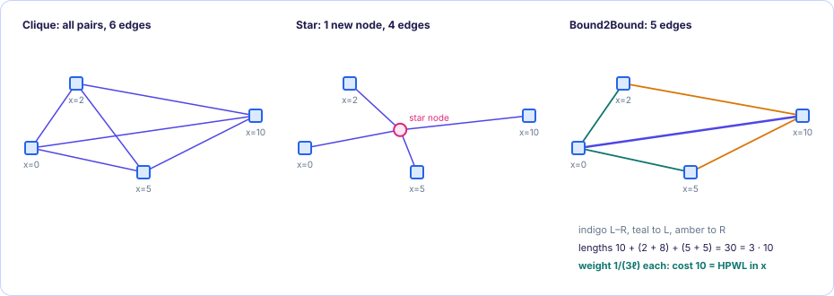

[← 4. Solving a million equations](04-solving-linear-systems.md) · [Foundations contents](README.md)

# 5. Net models: clique, star and Bound2Bound

*In the SimPL paper: §2, Equation 5.*

### 5.1 Two problems with plain squares

[Chapter 3](03-quadratic-placement.md) needs a graph with weighted edges, but nets are hyperedges. And even for a
two-pin net, $(x_1-x_2)^2$ is not HPWL: it punishes one long wire much more than
several short ones ($10^2 = 100$ but $5^2 + 5^2 = 50$).

### 5.2 Fixing the squares with a length-dependent weight

Here is the key trick. Suppose that at the current placement a two-pin net has
length $\ell = |x_1 - x_2|$. Give its edge the weight $w = 1/\ell$. Then its
quadratic cost is

$$
w(x_1 - x_2)^2 = \frac{\ell^2}{\ell} = \ell
$$

exactly the true (linear) length. The quadratic function now reports the true
length at the current placement, while still being a smooth quadratic that gives
linear equations. The price: the weight depends on the placement, so after cells
move it is out of date and must be recomputed. That is the paper's "the B2B model
captures the HPWL objective exactly, but only for the given placement".

> [!WARNING]
> If two pins coincide, $\ell = 0$ and $1/\ell$ is infinite. Implementations
> replace tiny lengths by a small minimum value. The paper does not discuss this
> detail.

### 5.3 Many-pin nets: connect to the bounds

For a net with $p$ pins, sort its pins by x. Call the leftmost pin $L$ and the
rightmost $R$: the two **bounds**. The B2B model adds these edges:

- one edge $L$–$R$;
- for every inner pin $k$, an edge $k$–$L$ and an edge $k$–$R$.

That is $1 + 2(p-2) = 2p - 3$ edges (a clique would use $p(p-1)/2$, many more for
$p > 3$; for $p=3$ the B2B edges *are* the clique, as the paper notes). The weight
of the edge between pins $i$ and $j$ is

$$
w_{ij} = \frac{2}{p-1}\cdot\frac{1}{|x_i - x_j|} \qquad \text{(Eq. 5)}
$$

**Derivation: why $1/(p-1)$.** Let $D = x_R - x_L$, the net's x extent (its HPWL in
x). Add up the lengths of all B2B edges:

- the $L$–$R$ edge has length $D$;
- for an inner pin $k$, its two edges have lengths $(x_k - x_L) + (x_R - x_k) = D$.
  There are $p - 2$ inner pins.

Total edge length $= D + (p-2)D = (p-1)D$. With weight $\frac{1}{p-1}\cdot\frac1\ell$
on every edge, each edge's quadratic cost is $\ell/(p-1)$ ([§5.2](#52-fixing-the-squares-with-a-length-dependent-weight)), and the sum is

$$
\sum \frac{\ell}{p-1} = \frac{(p-1)D}{p-1} = D = \text{HPWL in x}
$$

So with $1/(p-1)$ the quadratic cost equals HPWL exactly at the current placement.
The extra factor 2 in Eq. 5 (it comes from Kraftwerk2, where B2B was invented)
multiplies every net by the same constant, so it only rescales the cost and does
not move the minimum ([§3.4](03-quadratic-placement.md#34-matrix-form-equation-3)). The paper's text is also loose with this factor ("weight
1/length" for two-pin nets, "1/2l" for three-pin nets); it never affects anything.

**Example.** A 4-pin net at x = 0, 2, 5, 10, so $D = 10$, $p = 4$.
Edges and lengths: $0$–$10$: 10; $2$–$0$: 2; $2$–$10$: 8; $5$–$0$: 5; $5$–$10$: 5.
Total length $= 30 = (p-1)D = 3\cdot10$ ✓. With weights $\frac{1}{3\ell}$, the
quadratic cost is $30/3 = 10 = D$ ✓. For comparison, a plain clique with unit weights
would cost $2^2+5^2+10^2+3^2+8^2+5^2 = 227$: nothing like 10.

The x and y graphs are built separately ($G_x$ and $G_y$): which pins are the
bounds, and the lengths, differ in each direction.

<figure class="kt-figure" markdown="span">
  
  <figcaption>The 4-pin example net (x = 0, 2, 5, 10) under the three net models of §5.4.</figcaption>
</figure>

### 5.4 B2B versus star and clique

- **Clique**: an edge between every pair of pins, weight independent of placement.
  Too many edges for big nets and not HPWL-accurate.
- **Star**: add one new imaginary node per net in its middle and connect every pin
  to it. Few edges, but adds new variables (bigger matrix).
- **B2B**: few edges, no new variables, and exact at the current placement. Its
  only drawback is that it must be rebuilt as the placement changes. Most placers
  avoided that cost; SimPL accepts it because the rebuild is cheap compared with
  the gain in accuracy.

> [!IMPORTANT]
> **Key takeaways**
>
> - A weight of 1/length makes a squared cost equal the true length at the current placement.
> - Bound2Bound joins every pin to the net's two extreme pins with weight $\frac{1}{(p-1)\,\ell}$ (up to a constant), which equals HPWL exactly.
> - It uses fewer edges than a clique and no extra variables like a star, but it must be rebuilt as cells move.

### Exercises

**1.** A 3-pin net has pins at $x = 1, 4, 9$. List its B2B edges with their weights $\frac{1}{(p-1)\ell}$, and check that the quadratic cost equals the HPWL in x.

Answer

$p = 3$. Edges: $1$–$9$ ($\ell = 8$, $w = 1/16$), $4$–$1$ ($\ell = 3$, $w = 1/6$), $4$–$9$ ($\ell = 5$, $w = 1/10$). Each edge costs $w\ell^2 = \ell/2$, so the total is $(8 + 3 + 5)/2 = 8 = 9 - 1$.

**2.** A net has 10 pins. How many edges do a clique, a star and B2B use?

Answer

Clique: $10\cdot9/2 = 45$ edges. Star: 10 edges, plus one extra variable for the star node. B2B: $2p - 3 = 17$ edges and no extra variables.

**3.** Why must the B2B graph be rebuilt after the cells move?

Answer

Its weights depend on the current edge lengths, and which pins are the extremes $L$ and $R$ can change. After a move, the quadratic cost no longer equals HPWL until the graph is rebuilt.

---

[← 4. Solving a million equations](04-solving-linear-systems.md) · [Foundations contents](README.md)
