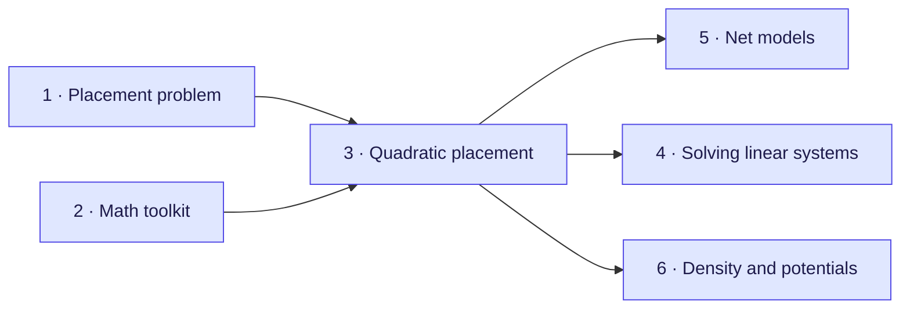

[Documentation home](../README.md)

# Foundations

The background that every algorithm guide relies on. It assumes basic calculus
(derivatives, $\sum$ notation) and no linear algebra. Every equation is derived step
by step, with small numerical examples. The worked examples follow the SimPL paper,
so each chapter notes the section of that paper it covers.

| # | Chapter | What you learn |
| --- | --- | --- |
| 1 | [The placement problem and wirelength](01-placement-problem.md) | cells, nets, the density limit, the three placement stages, how wire is measured (HPWL) |
| 2 | [The math toolkit, gently](02-math-toolkit.md) | notation, vectors, matrices, derivatives with many variables, "bowls", big-O |
| 3 | [Quadratic placement](03-quadratic-placement.md) | wires as springs, the linear system $Q\vec x = \vec b$, a worked example, why everything collapses |
| 4 | [Solving a million equations](04-solving-linear-systems.md) | Jacobi, conjugate gradient, condition number, preconditioning |
| 5 | [Net models: clique, star and Bound2Bound](05-net-models.md) | turning a many-pin net into springs; Bound2Bound measures HPWL exactly |
| 6 | [Density, potentials and Poisson's equation](06-density-and-potentials.md) | demand and supply on a grid, a potential landscape, Poisson's equation, solving it with cosine waves |

Chapter 2 is the longest; read it slowly, and come back to its notation table
(§2.1) whenever a formula looks unfamiliar. Readers who know linear algebra can skip
chapter 2 and skim chapter 4.

After the foundations, continue with an algorithm guide, for example
[SimPL](../global-placement/simpl/README.md).
