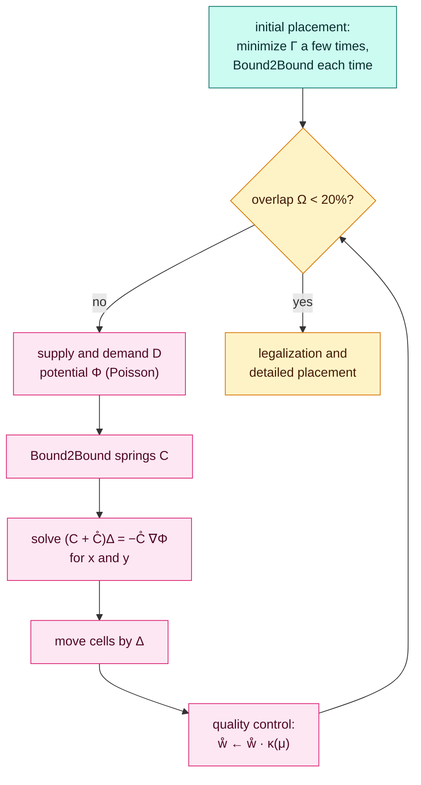

[← 2. Density, potential and target points](02-density-and-potential.md) · [Kraftwerk2 overview](README.md) · [4. Final placement, results and complexity →](04-results.md)

# 3. Quality control and convergence

*In the paper: §VI, §VII and §X, equations (31)–(40), Figures 7–9 and 12.*

### 3.1 Why movement costs quality

Bound2Bound measures HPWL exactly, but only at the positions where its weights were
computed ([Foundations §5.2](../../foundations/05-net-models.md#52-fixing-the-squares-with-a-length-dependent-weight)).
The farther the cells move within one iteration, the more the springs misjudge the
real wirelength. The paper measures this (Figure 5): the error grows with the
average movement $\mu$, for every net model. **Small steps give good placements;
large steps give fast ones.** Kraftwerk2 lets the user choose the step size
directly.

### 3.2 The move weights (31)

The stiffness of each module's move spring starts at

$$
\mathring w_i = \frac{A_i}{A_\text{avg}}\cdot\frac1M \qquad \text{(31)}
$$

- $A_i/A_\text{avg}$: big modules get stiffer springs and move farther, out of the
  way of the small ones, which then need to move less. That helps wirelength, since
  most nets connect small cells.
- $1/M$ ($M$ movable modules): with more modules the initial placement is more
  contracted and the targets are farther away, so a fixed weight would make the move
  force grow with the design. Dividing by $M$ keeps it in proportion.

**Example.** Four modules of area 1, 1, 2 and 4: $A_\text{avg} = 2$, $M = 4$, so the
weights are $0.125$, $0.125$, $0.25$ and $0.5$.

### 3.3 Steering the movement (32)

The user sets a target movement $\mu_T$; a good rule of thumb is the average module
size. After every iteration, Kraftwerk2 measures the average movement

$$
\mu = \frac1M\sum_i \big|(\Delta x_i, \Delta y_i)\big|
$$

and multiplies every move weight by a factor $\kappa$ (32):

$$
\kappa = 1 + \tanh\!\left(\ln\frac{\mu_T}{\mu}\right)
$$

Too little movement ($\mu < \mu_T$) gives $\kappa > 1$, stiffer springs and longer
steps next time; too much gives $\kappa < 1$. The formula has a simple form: with
$r = \mu_T/\mu$, $\tanh(\ln r) = \dfrac{r - 1/r}{r + 1/r} = \dfrac{r^2 - 1}{r^2 + 1}$, so

$$
\kappa = \frac{2r^2}{r^2 + 1}
$$

| $\mu_T/\mu$ | 0.25 | 0.5 | 1 | 2 | 4 |
| --- | ---: | ---: | ---: | ---: | ---: |
| $\kappa$ | 0.12 | 0.4 | 1 | 1.6 | 1.88 |

The factor stays between 0 and 2, so the weights change gently and never jump.

The trade-off is the paper's Figure 9: a small $\mu_T$ means many iterations and a
short wirelength, a large one the opposite.

### 3.4 How much overlap is left (35)

Let $A_\cup$ be the area covered by at least one module and $A_\text{mod}$ the sum of
all module areas. The **overlap** is

$$
\Omega = 1 - \frac{A_\cup}{A_\text{mod}} \qquad \text{(35)}
$$

0 means no two modules overlap; values near 1 mean almost everything is stacked.

**Example.** Two modules of area 4 that overlap in an area of 1: $A_\cup = 7$,
$A_\text{mod} = 8$, so $\Omega = 1/8 = 0.125$.

Global placement stops when $\Omega$ falls below 20%; the rest is the legalizer's job.

### 3.5 Why it converges (36)–(40)

The placement matrix $C_x$ is strongly diagonally dominant
([Foundations §3.7](../../foundations/03-quadratic-placement.md#37-why-q-is-a-strictly-convex-bowl-spd-and-diagonal-dominance)),
so approximate it by its diagonal $\alpha_{x,i}$. Then row $i$ of (30) becomes the
one-cell example of [chapter 1](01-forces.md#15-one-cell-by-hand):

$$
\Delta x_i = -\beta_{x,i}\,\frac{\partial\Phi}{\partial x}\bigg|_{(x'_i, y'_i)},
\qquad \beta_{x,i} = \frac{\mathring w_i}{\alpha_{x,i} + \mathring w_i},\quad 0 < \beta \le 1 \qquad \text{(38)}
$$

A module moves at most the length of the potential's slope, so the average movement
is bounded by the average slope $\delta$:

$$
\mu \le \delta = \frac1M\sum_i \big|\nabla\Phi(x'_i, y'_i)\big| \qquad \text{(36), (40)}
$$

As the modules spread, the density evens out, the landscape flattens, and $\delta$
shrinks every iteration; so does the overlap. The paper's convergence plot (Figure
12) shows three phases: $\mu$ starts small (the weights start small), rises to
$\mu_T$ under quality control, and finally falls with $\delta$ once the remaining
crowding is too little to push that far.

**A limitation the paper names.** Two modules exactly on top of each other, with the
same neighbours, always get the same target and never separate. Real netlists do not
produce such pairs, but a hand-made test netlist can.

### 3.6 The whole algorithm (Figure 7)

> [!IMPORTANT]
> **Key takeaways**
>
> - Moving less per iteration keeps Bound2Bound accurate, so step size trades runtime for quality.
> - Move weights start at $A_i/(A_\text{avg}M)$ and are scaled each iteration by $\kappa = 2r^2/(r^2 + 1)$, $r = \mu_T/\mu$.
> - Overlap $\Omega = 1 - A_\cup/A_\text{mod}$; global placement stops below 20%.
> - Each module moves at most the slope of the potential, which flattens as the cells spread: that is why it converges.

### Exercises

**1.** An iteration moved the cells twice as far as $\mu_T$. By what factor are the move weights scaled?

Answer

$r = \mu_T/\mu = 0.5$, so $\kappa = 2 \cdot 0.25 / 1.25 = 0.4$: the springs get much softer.

**2.** Three modules of area 2 sit exactly on top of each other. What is $\Omega$?

Answer

$A_\cup = 2$ and $A_\text{mod} = 6$, so $\Omega = 1 - 2/6 = 2/3$.

---

[← 2. Density, potential and target points](02-density-and-potential.md) · [Kraftwerk2 overview](README.md) · [4. Final placement, results and complexity →](04-results.md)
