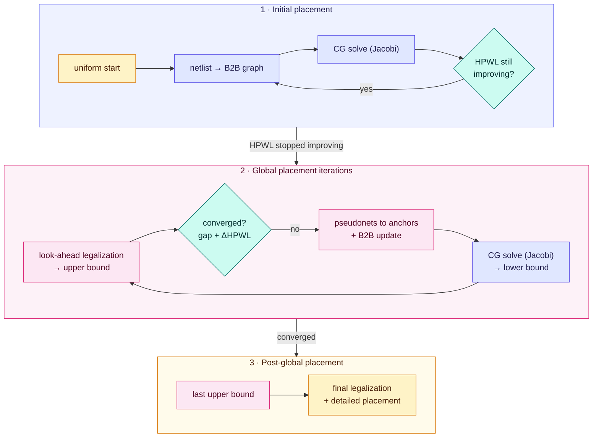

[SimPL contents](README.md) · [2. Look-ahead legalization →](02-look-ahead-legalization.md)

# 1. The SimPL idea and initial placement

*In the paper: §3, §4.1, Figure 2.*

### 1.1 Two placements that squeeze together

Most analytic placers start from the collapsed clump of [Foundations §3.8](../../foundations/03-quadratic-placement.md#38-the-catch-everything-collapses) and spread it slowly
over hundreds of small steps. SimPL instead keeps **two** placements at every
iteration:

- **Lower-bound placement** (blue in the paper's figures): the solution of the
  linear system. It ignores overlap, so its wirelength is optimistic, lower than
  any legal placement will reach. It is produced by the **linear system solver
  (LSS)**.
- **Upper-bound placement**: the lower-bound placement pushed, quickly and
  roughly, into an almost legal (spread-out, density-respecting) placement. Its
  wirelength is pessimistic: a good final placement should do at least this well.
  It is produced by **look-ahead legalization (LAL)**.

(These are "bounds" in an engineering sense, used to watch progress; the paper does
not prove a strict mathematical bound.)

Each iteration:

1. LAL turns the current lower bound into an upper bound.
2. Every cell gets an **anchor** at its upper-bound location, and an imaginary
   spring (**pseudonet**) pulls the cell toward its anchor.
3. The linear system, now including the anchor springs, is solved again: a new
   lower bound, a little more spread out and pulled toward the free space.

The anchors answer both questions of [Foundations §3.8](../../foundations/03-quadratic-placement.md#38-the-catch-everything-collapses) at once. **Direction**: toward where LAL
found room. **Strength**: the anchor springs' weight, which grows over the
iterations in a controlled way. As the lower bound spreads, LAL has less to fix, the
two placements get closer, and the **gap** between their wirelengths shrinks. When
the gap is small, the upper bound is the answer. The name **look-ahead** comes from
step 1: each upper bound is a "preview" of a legal placement that is used once as a
target and then thrown away, never refined directly.

The flow (paper Figure 2):

### 1.2 Initial placement

1. Put the movable cells at a **uniformly distributed** starting placement (the B2B
   weights need *some* placement to measure lengths from).
2. Build the B2B graph ([Foundations chapter 5](../../foundations/05-net-models.md)), solve $Q\vec x = \vec b$ and $Q\vec y = \vec b_y$
   with Jacobi-preconditioned CG ([Foundations chapter 4](../../foundations/04-solving-linear-systems.md)).
3. The B2B weights are now stale because cells moved, so rebuild the graph and
   solve again.
4. Repeat until HPWL stops improving.

This step completely ignores cell sizes and overlap; its result is the collapsed,
wirelength-optimal clump. Why bother iterating? The authors found that this first
shape strongly influences the final result, and B2B is more accurate than the
star/clique models other placers used here. Only 5–7 rounds are needed regardless of
design size, because the *relative order* of cells settles quickly.

> [!IMPORTANT]
> **Key takeaways**
>
> - SimPL keeps two placements: a lower bound (the linear solve, overlapping) and an upper bound (look-ahead legalized, nearly legal).
> - Anchors tie each cell to its upper-bound location, which settles both the direction and the strength of spreading.
> - Initial placement alternates Bound2Bound rebuilds and CG solves for 5 to 7 rounds, ignoring overlap.

---

[SimPL contents](README.md) · [2. Look-ahead legalization →](02-look-ahead-legalization.md)
