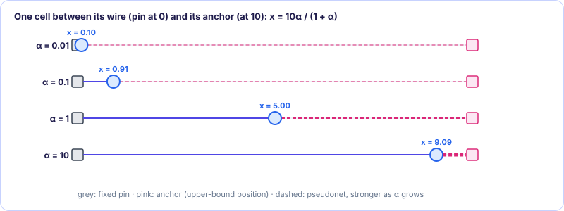

[← 2. Look-ahead legalization](02-look-ahead-legalization.md) · [SimPL contents](README.md) · [4. Speed, results and parallelism →](04-speed-results-parallelism.md)

# 3. Anchors and convergence

*In the paper: §4.3, Figures 6–8.*

### 3.1 Adding an anchor changes only the diagonal and the right-hand side

Each movable cell $i$ gets a **fixed, zero-area anchor** at its upper-bound
position $a_i$, connected to the cell by a two-pin **pseudonet** (a made-up net
that exists only in the math, paper Figure 6). Its spring adds a term
$w_i (x_i - a_i)^2$ to the cost. Differentiate:

$$
\frac{\partial}{\partial x_i}\,w_i(x_i - a_i)^2 = 2w_i x_i - 2w_i a_i
$$

Compared with [Foundations §3.5](../../foundations/03-quadratic-placement.md#35-the-worked-example-figure-1-and-equation-4), the $x_i$ part goes into the diagonal and the $a_i$ part into the
right-hand side, because an anchor is a fixed cell:

$$
Q_{ii} \leftarrow Q_{ii} + w_i, \qquad b_i \leftarrow b_i + w_i\,a_i
$$

Consequences, which the paper points out:

- The matrix does **not** grow (anchors are fixed, so no new unknowns) and gets no
  new off-diagonal entries.
- Every diagonal entry grows, so $Q$ becomes **more diagonally dominant**: better
  condition number of $P^{-1}Q$, faster Jacobi-preconditioned CG ([Foundations §4.5](../../foundations/04-solving-linear-systems.md#45-condition-number-and-preconditioning)).
- Every cell now has a fixed connection, so $Q$ is always nondegenerate ([Foundations §3.7](../../foundations/03-quadratic-placement.md)).

### 3.2 The anchor weight and its schedule

The anchor weight is a B2B-style weight times a factor α:

$$
w_i = \frac{\alpha}{|x_i - a_i|}
$$

With the trick of [Foundations §5.2](../../foundations/05-net-models.md#52-fixing-the-squares-with-a-length-dependent-weight), its cost at the current placement is
$\frac{\alpha}{\ell}\ell^2 = \alpha\,\ell$: α times the (Manhattan) distance between
cell and anchor. And α grows with the iteration number:

$$
\alpha = 0.01 \times (1 + \text{iteration number})
$$

- **Early**: α is small. The anchors pull weakly; wirelength still dominates, and the
  solver has freedom to rearrange cells.
- **Later**: the relative order has settled and α is larger. The anchors pull
  harder, forcing the lower bound toward the upper bound and closing the gap.

**One-cell example.** A cell connected by a unit spring to a fixed pin at 0, with its
anchor at $a = 10$ and (for simplicity) a fixed anchor weight $\alpha$:

$$
\Phi = x^2 + \alpha(x - 10)^2,\qquad \Phi' = 2x + 2\alpha(x - 10) = 0 \;\Rightarrow\; x = \frac{10\alpha}{1+\alpha}
$$

| α | 0.01 | 0.1 | 1 | 10 |
| --- | --- | --- | --- | --- |
| x | 0.10 | 0.91 | 5.0 | 9.1 |

As α grows the cell moves smoothly from where the wire wants it (0) to where the
legalizer put it (10). That is the force-modulation problem solved by a schedule.

<figure class="kt-figure" markdown="span">
  
  <figcaption>The one-cell example: as α grows, the cell slides from where its wire wants it (0) to its anchor (10).</figcaption>
</figure>

Move the slider to change α, or press *Play* to grow it. The two arrows are the
wire's pull toward the pin and the anchor's pull toward the legalized position. They
are always equal, because the cell sits where they balance, but the balance point
slides toward the anchor as α grows. The scale is logarithmic, so each third of the
slider is ten times more α.

### 3.3 α as a Lagrange multiplier

A **Lagrange multiplier** is the price you pay per unit of violating a constraint.
Here the constraint is "every cell sits on its anchor" and the penalty is the
distance from the anchor ([§3.2](#32-the-anchor-weight-and-its-schedule)); α is its price. Raising the price over time shifts
the optimization from "short wires" to "satisfy the constraints" (paper Figure 6).
(The authors improved this weighting later in their ComPLx placer, footnote *d*.)

### 3.4 The main loop and when to stop

Each global placement iteration:

1. Look-ahead legalization: lower bound → upper bound ([Chapter 2](02-look-ahead-legalization.md)).
2. Update the anchors to the new upper bound and rebuild the B2B graphs at the
   current lower-bound placement, with the anchor springs ([Foundations chapter 5](../../foundations/05-net-models.md), [§3.1](#31-adding-an-anchor-changes-only-the-diagonal-and-the-right-hand-side)).
3. Solve the linear systems with Jacobi-preconditioned CG → new lower bound ([Foundations chapter 4](../../foundations/04-solving-linear-systems.md)).

**Stopping.** The naive rule "stop when the upper bound's HPWL stops improving"
does not work: during the first 4–7 iterations the upper bound oscillates (paper
Figure 7) and would stop too early. So SimPL watches the **gap**
$=$ HPWL(upper) $-$ HPWL(lower), measured relative to the gap at iteration 10, and
stops when

1. the gap is at most **25%** of the iteration-10 gap **and** the upper bound has
   stopped improving, or
2. the gap is below **10%** of the iteration-10 gap.

On ISPD 2005 benchmarks this takes 33–45 iterations. The **last upper-bound
placement** is the global placement result; it then goes to final legalization and
detailed placement.

**Why it converges.** α keeps growing, so the anchors pull the lower bound ever
closer to an almost legal placement. A less overlapped lower bound needs smaller
moves from LAL, so the next upper bound is close to it. After the first few
iterations the two curves approach each other monotonically.

**Reading Figure 7 (adaptec1).** The upper-bound HPWL starts high (~1.5e8) and comes
down; the lower bound starts low (~4.5e7) and goes up; they close in on each other
near the wirelength of the final legal placement (7.74e7 for adaptec1 in Table 1)
within about 40–50 iterations. The "scaled overflow per bin" of the lower bound (how much it
overfills the bins) falls toward zero. The legal placement's HPWL ends close to the
upper bound, showing that the upper bound is a realistic estimate. Figure 8 shows
snapshots: iteration 0 is the clump (HPWL 4.48e7), iteration 1's upper bound has
HPWL 1.50e8, and by iteration 20–21 the lower and upper placements look alike
(6.82e7 versus 8.57e7).

> [!IMPORTANT]
> **Key takeaways**
>
> - An anchor adds only to the diagonal and the right-hand side: the matrix does not grow and CG gets faster.
> - The anchor weight is $\alpha$/distance with $\alpha = 0.01(1 + \text{iteration})$: weak at first, strong later.
> - The loop stops when the gap between the bounds is small compared with iteration 10; the last upper bound is the result.

### Exercises

**1.** A cell is wired to a fixed pin at 0 (weight 1), with its anchor at 10 and a fixed anchor weight $\alpha$. Where is it for $\alpha = 0.25$ and for $\alpha = 4$?

Answer

$x = \frac{10\alpha}{1 + \alpha}$: $\frac{2.5}{1.25} = 2$ for $\alpha = 0.25$, and $\frac{40}{5} = 8$ for $\alpha = 4$.

**2.** What is $\alpha$ at iteration 20?

Answer

$\alpha = 0.01 \times (1 + 20) = 0.21$.

**3.** The gap at iteration 10 was $4\times10^7$. At iteration 35 it is $3.5\times10^6$. Does SimPL stop?

Answer

Yes. $3.5\times10^6$ is below 10% of the iteration-10 gap ($4\times10^6$), which stops the loop regardless of whether the upper bound is still improving.

---

[← 2. Look-ahead legalization](02-look-ahead-legalization.md) · [SimPL contents](README.md) · [4. Speed, results and parallelism →](04-speed-results-parallelism.md)
