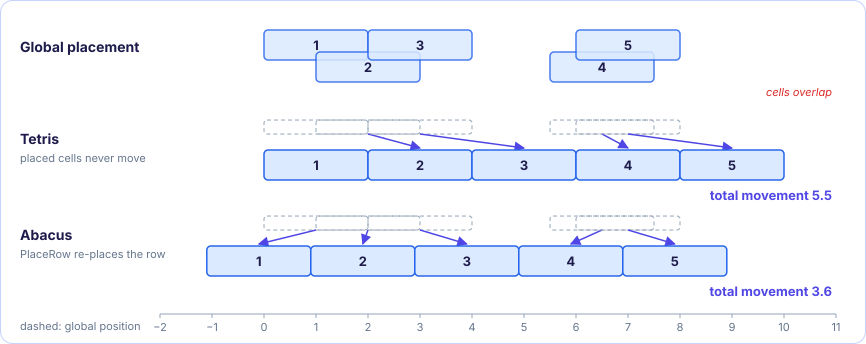
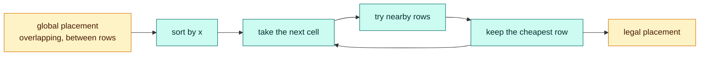
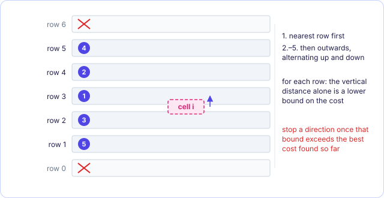

[Abacus contents](README.md) · [2. PlaceRow →](02-placerow.md)

# 1. Legalization, Tetris and the Abacus loop

*In the paper: §1, §2, Algorithm 1, Figure 1.*

**Goal:** turn a global placement into a legal one while disturbing it as little as
possible.

### 1.1 What legalization asks for

A **standard cell circuit** is made of cells that all have the same height and
different widths (inverters, NANDs, NORs, flip-flops). The chip is organized in
horizontal **rows** of that height, and every cell must end up

1. **in a row**: its bottom edge on a row's y-coordinate, and
2. **without overlap**: no two cells in a row share any x.

Global placement does not deliver that. It spreads the cells so that no region is
over-full, but the cells still overlap a little and sit between rows. **Legalization**
fixes both, and nothing else.

Global placement has already optimized everything that matters (wirelength, timing,
routability). Every cell that legalization moves is a step away from that optimum. So
the objective is

> **move the cells as little as possible.**

The paper measures this as **movement**: the distance between a cell's position in the
global placement $(x'_i, y'_i)$ and its legal position $(x_i, y_i)$. Positions are the
lower-left corner of the cell.

Two assumptions keep the problem simple:

- Macros (big non-standard cells), if any, are already placed and fixed.
- Rows blocked by a macro are cut into **subrows** that are not blocked. From here on
  a "row" means one of these unblocked pieces, with a left end $x_{\min}$ and a right
  end $x_{\max}$.

### 1.2 Tetris and its weakness

**Tetris** (D. Hill, US patent 6370673, 2002) is the classic greedy legalizer, and
Abacus starts from it:

1. Sort the cells by their global x-position.
2. Take the cells one at a time. For each one, look over the rows and, inside a row,
   over the free sites, and put the cell in the **nearest free site**.
3. Once a cell is placed it **never moves again**.

Step 3 is the problem. The first cells of a crowded area take the best sites and move
very little; the cells that come later find those sites taken and have to go far.
Paper Figure 1 shows seven cells: Tetris moves cells 1, 2 and 3 a little and cells 4 to
7 a lot, for a total movement of 3.752. Abacus legalizes the same placement with a total
of 2.915, by letting cells 1, 2 and 3 move a bit further so that 4 to 7 do not have to.


<figure class="kt-figure" markdown="span">
  [](images/tetris-vs-abacus.svg)
  <figcaption>The same effect on the five cells of the worked row in chapter 3: Tetris (sites at integers) leaves the early cells alone and pushes the late ones far; Abacus shifts everyone a little.</figcaption>
</figure>



### 1.3 The Abacus idea

Abacus keeps the Tetris skeleton (sort, then one cell at a time, then pick the best
row) but changes what "putting a cell in a row" means:

> When cell $i$ is put into a row, **all the cells already in that row are re-placed**
> so that the *total* movement of the row is as small as possible.

Cells in a row may slide left or right, but they keep their left-to-right order: if
$a$ is left of $b$ in the legal row, $a$ was left of $b$ in the global placement. This
is **PlaceRow**, the subject of chapters [2](02-placerow.md) and
[3](03-clusters-and-dynamic-programming.md). The order is kept because the global
placer chose it for good reasons, and because keeping it turns the row problem into an
easy one.

### 1.4 Algorithm 1

```
Algorithm 1: Abacus
 1  sort cells by x-position
 2  for each cell i:
 3      c_best ← ∞
 4      for each row r:
 5          insert cell i into row r
 6          PlaceRow r (trial)
 7          c ← cost of cell i's new position
 8          if c < c_best: c_best ← c, r_best ← r
 9          remove cell i from row r
10      end
11      insert cell i into row r_best
12      PlaceRow r_best (final)
13  end
```

- **Line 5, inserting.** Inside a row, the cells are kept in order of their global
  x-position. Because the cells are processed in sorted order (line 1), inserting cell
  $i$ always means **appending it at the right end** of the row.
- **Line 6, trial.** PlaceRow computes where every cell of the row would go, but those
  positions are only temporary: nothing is moved yet.
- **Line 7, cost.** The cost is the movement of **cell $i$ alone**, from its global
  position to its position in this row (the x-shift PlaceRow gives it, together with
  the y-shift to the row). The other cells' movement is not part of the row choice.
- **Line 12, final.** Only the winning row is placed for real.

### 1.5 Three practical details

**Not every row is tried.** Trying all rows for every cell would be slow. Instead,
the cell is first tried in the **nearest row** to its global y, then in the rows above
and below, moving outwards. For each row there is a cheap **lower bound** on the cost:
the cell must move at least the vertical distance to that row, even if its x does not
change. As soon as that lower bound is larger than the best cost found so far, every
row further out in that direction is worse too, and the search in that direction
stops. In practice only a few rows are tried per cell, which "improves the CPU time of
legalization drastically".


<figure class="kt-figure" markdown="span">
  [](images/row-search.svg)
  <figcaption>Rows are tried nearest first, then alternately above and below; a direction stops once the vertical distance alone exceeds the best cost.</figcaption>
</figure>

**Both sort directions.** The cells can be sorted by increasing x (inserting each at
the right end of a row) or by decreasing x (inserting at the left end). The two give
different results. The paper recommends trying both and keeping the better one; the
difference in total movement is about 0.5%.

**Weights.** Each cell has a weight $e_i > 0$ that says how much its movement counts.
It can be 1 for every cell, the cell's area, or its number of pins. A heavier cell is
moved less.

> [!IMPORTANT]
> **Key takeaways**
>
> - Legalization puts every cell in a row without overlap and moves cells as little as possible.
> - Tetris places cells one at a time and never moves a placed cell, so late cells move far.
> - Abacus places cells one at a time too, but re-places the whole row (PlaceRow) each time, keeping the cells' order.
> - Rows are tried outwards from the nearest one and the search stops once the vertical distance alone exceeds the best cost.

### Exercises

**1.** Why does Tetris produce a high total movement on a crowded area, even though
each cell goes to its nearest free site?

<details class="success" markdown>
<summary>Answer</summary>

"Nearest" is judged one cell at a time. The first cells take the sites closest to
them, and since they are never moved again, the cells processed later find those
sites taken and must go further. The greedy choice is good for each cell when it is
made, but bad for the total.

</details>

**2.** Rows are 10 units apart. A cell's global y is 3 (the nearest row is at y = 0).
In row 0 its cost is 4. Is it worth trying the row at y = 10? The row at y = 20?

<details class="success" markdown>
<summary>Answer</summary>

Moving to the row at y = 10 means moving at least $10 - 3 = 7$ vertically, already
more than the best cost 4, so that row cannot win and neither can any row above it.
The search upwards stops without trying y = 10 or y = 20.

</details>

**3.** Why does sorting the cells by x make "insert cell $i$ into row $r$" cheap?

<details class="success" markdown>
<summary>Answer</summary>

Every cell already in the row has a global x no larger than cell $i$'s, so cell $i$
belongs at the right end. Inserting is appending; there is no search for its place
in the row.

</details>

---

[Abacus contents](README.md) · [2. PlaceRow →](02-placerow.md)
