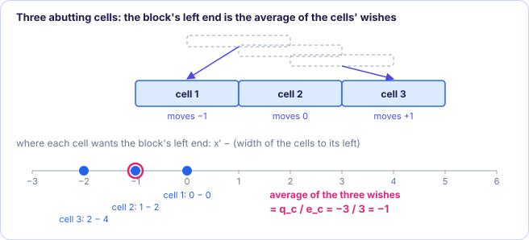

[← 1. Legalization, Tetris and the Abacus loop](01-legalization-and-tetris.md) · [Abacus contents](README.md) · [3. Clusters and dynamic programming →](03-clusters-and-dynamic-programming.md)

# 2. PlaceRow: one row as a quadratic program

*In the paper: §3, Tables 1–2, equations (1)–(5).*

**Goal:** given the cells of one row in their left-to-right order, find their legal
x-positions with no overlap and the smallest total (weighted, squared) movement.

### 2.1 The cells of one row

PlaceRow looks at one row only. The row holds $N_r$ cells, numbered $1, \dots, N_r$ in
order of their global x-position, so $x'_1 \le x'_2 \le \dots \le x'_{N_r}$. For each
cell $i$ (paper Table 1):

| Symbol | Meaning |
| --- | --- |
| $x'_i$ | x-position in the global placement (given) |
| $w_i$ | width (given) |
| $e_i$ | weight, e.g. 1, the area or the number of pins (given, $e_i > 0$) |
| $x_i$ | legal x-position (to be found) |

The legal y-position is not PlaceRow's business: it is the row's y, chosen by the
outer loop of [chapter 1](01-legalization-and-tetris.md).

### 2.2 The quadratic program

$$
\min_{x_1, \dots, x_{N_r}} \; \sum_{i=1}^{N_r} e_i \,(x_i - x'_i)^2
\tag{1}
$$

$$
\text{subject to}\quad x_i - x_{i-1} \ge w_{i-1}, \qquad i = 2, \dots, N_r
\tag{2}
$$

- **Objective (1)** adds up each cell's movement, squared and weighted. Squaring makes
  the function a smooth bowl (it is **convex** because every $e_i$ is positive), and
  it punishes one big move more than several small ones.
- **Constraint (2)** says cell $i$ starts at or after the right edge of cell $i-1$. That
  rules out overlap *and* keeps the order: cell $i$ can never jump to the left of cell
  $i-1$.

A problem with a squared objective and linear constraints is a **quadratic program**
(QP). A general QP solver (the paper mentions OOQP) can solve it, but slowly: the
inequality signs "$\ge$" are what make QPs hard, because the solver has to find out
which of them are tight.

### 2.3 The easy case: all cells abutting

Two cells **abut** when there is no gap between them in the legal placement:
$x_i - x_{i-1} = w_{i-1}$ exactly. Suppose for a moment that the optimum has *every*
cell of the row abutting its neighbour. Then every "$\ge$" in (2) is an "$=$", and each
position follows from the first one:

$$
x_i = x_1 + \sum_{k=1}^{i-1} w_k, \qquad i = 2, \dots, N_r
\tag{3}
$$

The whole row is one rigid block, and only its left end $x_1$ is free. Put (3) into
(1) and the objective becomes a function of the single number $x_1$:

$$
f(x_1) = \sum_{i=1}^{N_r} e_i \left(x_1 + \sum_{k=1}^{i-1} w_k - x'_i\right)^2
$$

That is a parabola opening upwards. Its lowest point is where the derivative is zero
([Foundations 2](../../foundations/02-math-toolkit.md)):

$$
f'(x_1) = 2\sum_{i=1}^{N_r} e_i \left(x_1 + \sum_{k=1}^{i-1} w_k - x'_i\right) = 0
$$

Split it into the part with $x_1$ and the part without (paper equation (4)):

$$
\underbrace{\sum_{i=1}^{N_r} e_i}_{e_c}\; x_1 \;-\;
\underbrace{\sum_{i=1}^{N_r} e_i\left(x'_i - \sum_{k=1}^{i-1} w_k\right)}_{q_c} = 0
\qquad\Longrightarrow\qquad
x_1 = \frac{q_c}{e_c}
\tag{5}
$$

**What $q_c / e_c$ means.** The term $x'_i - \sum_{k<i} w_k$ is "where cell $i$ wants
the *left end of the block* to be": if the block started there, cell $i$ would land
exactly on its global position. The optimal left end is the **weighted average** of
those wishes. With all weights equal, the cells' displacements cancel out on average:
some move left, some move right, and the mean movement is zero.

<figure class="kt-figure" markdown="span">
  
  <figcaption>The worked block below: each cell's wish for the block's left end, and their average, −1.</figcaption>
</figure>

### 2.4 Computing $e_c$, $q_c$ and $w_c$ one cell at a time

The sums in (5) can be built while walking the row from left to right (paper Table 2).
Keep three numbers, all starting at 0, and for each cell $i = 1, 2, \dots, N_r$:

| | Init | Iteration (cell $i$) |
| --- | --- | --- |
| total weight | $e_c = 0$ | $e_c \leftarrow e_c + e_i$ |
| weighted wishes | $q_c = 0$ | $q_c \leftarrow q_c + e_i\,(x'_i - w_c)$ |
| total width | $w_c = 0$ | $w_c \leftarrow w_c + w_i$ |

The order matters in the middle line: $q_c$ uses $w_c$ **before** cell $i$'s width is
added, because $w_c$ at that moment is $\sum_{k<i} w_k$, the width of the cells to the
left of $i$. After the last cell, $x_1 = q_c / e_c$ and (3) gives everyone else's
position. Each cell costs three additions and one multiplication.

> [!TIP]
> **A worked block.** Three cells, all weight 1, width 2, global positions $x' = 0, 1, 2$.
>
> | cell | $x'_i$ | $w_c$ before | wish $x'_i - w_c$ | $e_c$ | $q_c$ |
> | --- | --- | --- | --- | --- | --- |
> | 1 | 0 | 0 | 0 | 1 | 0 |
> | 2 | 1 | 2 | −1 | 2 | −1 |
> | 3 | 2 | 4 | −2 | 3 | −3 |
>
> $x_1 = -3/3 = -1$, so the cells go to $-1, 1, 3$. Movements: $-1, 0, +1$; they
> average to zero, as promised.

### 2.5 But the cells do not always abut

Equation (5) is only right if every cell of the row abuts its neighbours. Usually
that is false: a row has some free space, and the optimum leaves gaps where the cells
are not crowded. Placing every row as one solid block would push cells far from home
for nothing.

The way out is to cut the row into **clusters**: groups of cells that do abut, with
gaps between the groups. Inside each cluster (5) holds, so each cluster's position is
one division. Finding the right clusters, quickly, is the dynamic program of
[chapter 3](03-clusters-and-dynamic-programming.md).

> [!IMPORTANT]
> **Key takeaways**
>
> - PlaceRow minimizes $\sum e_i (x_i - x'_i)^2$ subject to no overlap and the original order.
> - If all cells in a group abut, the group is rigid and its left end is $x = q_c / e_c$: a weighted average of where each cell wants it.
> - $e_c$, $q_c$, $w_c$ are built cell by cell with $q_c \leftarrow q_c + e_i (x'_i - w_c)$, using $w_c$ before the cell is added.
> - Rows have gaps, so the row has to be split into abutting clusters.

### Exercises

**1.** Why does constraint (2) keep the cells' order, and not just prevent overlap?

Answer

It forces $x_i \ge x_{i-1} + w_{i-1} > x_{i-1}$: cell $i$ is always to the right of cell
$i-1$. A constraint that only prevented overlap would also allow cell $i$ to sit
entirely to the left of cell $i-1$.

**2.** Two cells of width 4 and weight 1 abut, with global positions $x' = 10$ and
$x' = 12$. Where does the pair go?

Answer

$e_c = 2$, $q_c = 1\cdot(10 - 0) + 1\cdot(12 - 4) = 18$, so $x_1 = 9$ and $x_2 = 13$.
Each moves 1, in opposite directions.

**3.** Same pair, but the first cell has weight 3. Where does the pair go now, and why?

Answer

$e_c = 4$, $q_c = 3\cdot 10 + 1\cdot 8 = 38$, so $x_1 = 9.5$ and $x_2 = 13.5$. The heavy
cell moves 0.5, the light one 1.5: its movement costs three times as much, so the
light cell takes most of the shift.

---

[← 1. Legalization, Tetris and the Abacus loop](01-legalization-and-tetris.md) · [Abacus contents](README.md) · [3. Clusters and dynamic programming →](03-clusters-and-dynamic-programming.md)
