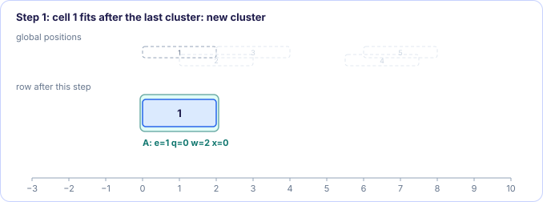
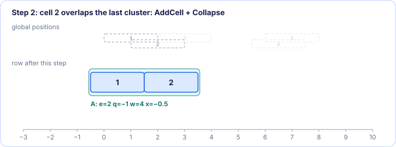
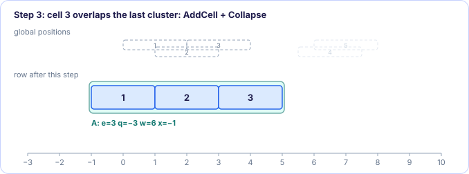
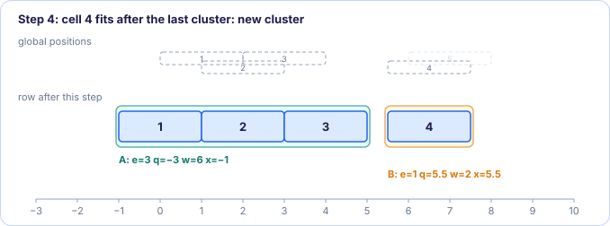
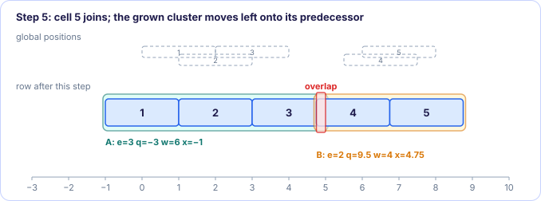
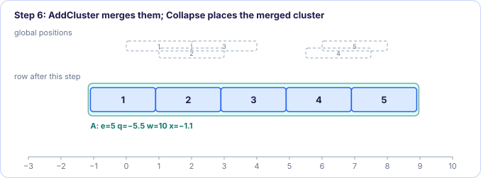

[← 2. PlaceRow](02-placerow.md) · [Abacus contents](README.md) · [4. Complexity and results →](04-complexity-and-results.md)

# 3. Clusters and dynamic programming

*In the paper: §4, Algorithm 2, Table 3.*

**Goal:** solve PlaceRow exactly, in time proportional to the number of cells in the
row, by discovering which cells end up abutting.

### 3.1 Clusters

A **cluster** is a run of consecutive cells of the row that abut each other in the
solution. Between two clusters there is a gap. Inside a cluster every constraint of
[chapter 2](02-placerow.md) is an equality, so the cluster is a rigid block and its best
left end is one division, $q_c / e_c$.

Each cluster $c$ keeps (paper Table 3):

| Symbol | Meaning |
| --- | --- |
| $n_{\text{first}}(c)$, $n_{\text{last}}(c)$ | its first and last cell |
| $e_c(c)$ | total weight of its cells |
| $w_c(c)$ | total width of its cells |
| $q_c(c)$ | the weighted wishes, as in chapter 2 |
| $x_c(c)$ | its position (left edge), $q_c(c)/e_c(c)$ clamped to the row |

The problem is that nobody knows the clusters in advance. The algorithm discovers
them from left to right: start every cell as its own cluster, and **merge** two clusters
as soon as their best positions would make them overlap. A merged cluster is never split
again.

### 3.2 Algorithm 2

```
Algorithm 2: PlaceRow
    // build the clusters and their positions
 1  for i = 1 .. N_r:
 2      c ← last cluster
 3      if i = 1 or x_c(c) + w_c(c) ≤ x'_i:        // cell i does not overlap c
 4          create a new cluster c
 5          e_c(c), w_c(c), q_c(c) ← 0
 6          x_c(c) ← x'_i
 7          n_first(c) ← i
 8          AddCell(c, i)
 9      else
10          AddCell(c, i)
11          Collapse(c)
12  end
    // give every cell its position
14  for each cluster c, left to right:
16      x ← x_c(c)
17      for each cell i of c:  x_i ← x;  x ← x + w_i

AddCell(c, i):                       // put cell i at the right end of c
    n_last(c) ← i
    e_c(c) ← e_c(c) + e_i
    q_c(c) ← q_c(c) + e_i · (x'_i − w_c(c))
    w_c(c) ← w_c(c) + w_i

AddCluster(c, c′):                   // put cluster c′ at the right end of c
    n_last(c) ← n_last(c′)
    e_c(c) ← e_c(c) + e_c(c′)
    q_c(c) ← q_c(c) + q_c(c′) − e_c(c′) · w_c(c)
    w_c(c) ← w_c(c) + w_c(c′)

Collapse(c):
    x_c(c) ← q_c(c) / e_c(c)                        // best position
    if x_c(c) < x_min:            x_c(c) ← x_min      // keep it inside the row
    if x_c(c) > x_max − w_c(c):   x_c(c) ← x_max − w_c(c)
    c′ ← predecessor of c
    if c′ exists and x_c(c′) + w_c(c′) > x_c(c):     // c now overlaps c′
        AddCluster(c′, c)
        remove c
        Collapse(c′)
```

Read it as three moves:

- **A cell that fits after the last cluster** (line 3) starts a new cluster at its
  own global position. Nothing moves.
- **A cell that would overlap the last cluster** (line 9) joins it (AddCell), and the
  grown cluster finds its new best position (Collapse).
- **Collapse can cascade.** Moving a grown cluster to its best position may shift it
  left, onto the cluster before it. Then the two merge (AddCluster) and the merged
  cluster collapses again, possibly onto the one before that, and so on.

### 3.3 Why AddCluster subtracts $e_c(c')\,w_c(c)$

$q_c$ adds up, for each cell, "where the cluster's left end should be for this cell
to sit on its global position": $x'_i$ minus the width of the cells to its left
*inside the cluster*. When cluster $c'$ is glued to the right of cluster $c$, every cell
of $c'$ suddenly has $w_c(c)$ more width to its left. Each of their wishes drops by
$w_c(c)$, weighted by the cell's $e_i$, so in total

$$
q_c(c') \;\longrightarrow\; q_c(c') - e_c(c')\, w_c(c),
$$

which is exactly the AddCluster line. AddCell is the same rule for a cluster of one
cell. Both are constant time, whatever the cluster's size.

### 3.4 Clamping to the row

The best position $q_c/e_c$ may lie partly outside the row. Collapse clamps it so the
cluster stays between $x_{\min}$ and $x_{\max}$. Clamping only ever pushes a cluster
*inwards*. If the cluster is pushed left against its predecessor, the overlap test merges
them as usual. If the clusters of a row add up to more than the row's width, the row has
no legal placement at all; Algorithm 1 then sees a cell that does not fit and does not
choose that row.

### 3.5 A worked row

Five cells, all of width 2 and weight 1, in a long row; global positions
$x' = 0, 1, 2, 5.5, 6$.

| step | action | cluster(s) after the step |
| --- | --- | --- |
| cell 1 | new cluster A | A: $e=1, q=0, w=2$, $x=0$ |
| cell 2 | $x'_2 = 1 < 0 + 2$: overlap, AddCell(A) | A: $e=2, q = 0 + (1-2) = -1, w=4$ |
| | Collapse(A) | A: $x = -0.5$ |
| cell 3 | $2 < -0.5 + 4$: overlap, AddCell(A) | A: $e=3, q = -1 + (2-4) = -3, w=6$ |
| | Collapse(A) | A: $x = -1$ (cells at −1, 1, 3) |
| cell 4 | $5.5 \ge -1 + 6$: fits, new cluster B | B: $e=1, q=5.5, w=2$, $x=5.5$ |
| cell 5 | $6 < 5.5 + 2$: overlap, AddCell(B) | B: $e=2, q = 5.5 + (6-2) = 9.5, w=4$ |
| | Collapse(B): $x = 4.75$, but A ends at 5 | B overlaps A |
| | AddCluster(A, B) | A: $e=5$, $q = -3 + 9.5 - 2\cdot 6 = -5.5$, $w=10$ |
| | Collapse(A): $x = -5.5/5 = -1.1$ | A alone, no predecessor |

Final positions: $-1.1, 0.9, 2.9, 4.9, 6.9$. Movements: $-1.1, -0.1, +0.9, -0.6, +0.9$.
They sum to zero: one rigid block of equal weights, centred on its cells' wishes.


Notice what cell 5 did: it did not fit next to cell 4, pushed cluster B left into
cluster A, and in the end shifted all five cells a little. Tetris, on integer sites, never
moves a placed cell: cells 1 to 5 go to 0, 2, 4, 6, 8, with movements 0, 1, 2, 0.5, 2.
Total movement: 5.5 for Tetris against 3.6 for Abacus.

The same row, one step at a time (click through the tabs):

=== "Step 1"

    [{ .kt-step }](images/placerow-step1.svg)

=== "Step 2"

    [{ .kt-step }](images/placerow-step2.svg)

=== "Step 3"

    [{ .kt-step }](images/placerow-step3.svg)

=== "Step 4"

    [{ .kt-step }](images/placerow-step4.svg)

=== "Step 5"

    [{ .kt-step }](images/placerow-step5.svg)

=== "Step 6"

    [{ .kt-step }](images/placerow-step6.svg)

### Try it yourself

Drag the pink cells along the top lane: they are the global positions. The middle lane is PlaceRow's result, with its clusters shaded; the bottom lane is Tetris, which never moves a cell it has placed. Pile several cells on top of each other and watch clusters form, merge and push each other.

<div class="kt-widget" data-widget="placerow"></div>

### 3.6 Why it is optimal

The objective is convex, the cells keep their order, and the algorithm only merges two
clusters when, at their own best positions, they would overlap: at that point there is
no solution in which a gap separates them, because opening one would mean moving one
of the two away from its best position in the wrong direction. The paper does not repeat
the full proof. It points out that the same structure (no overlap, fixed order, convex
objective) is the one for which Kahng, Tucker and Zelikovsky proved the optimality of a
similar clustering dynamic program for linear wirelength, and that the proof carries over.

The difference from that earlier program is the objective. Squared movement makes each
cluster's optimum a single division. A linear objective would make each cluster's cost a
piecewise-linear function whose minimum has to be found by walking its corners, which is
slower and needs more elaborate data structures. Abacus needs nothing but arrays.

> [!NOTE]
> In Algorithm 1 the cell being legalized is always appended at the right end of the
> row. The clusters of the cells already in the row are the ones the previous PlaceRow
> found, so a trial only has to run lines 9–11 for the new cell: AddCell to the last
> cluster and the Collapse cascade.

> [!IMPORTANT]
> **Key takeaways**
>
> - A cluster is a run of abutting cells; it is rigid, and its position is $q_c/e_c$ clamped to the row.
> - Cells are processed left to right; a cell that overlaps the last cluster joins it, and Collapse merges clusters leftwards as long as they overlap.
> - AddCell and AddCluster update $e_c$, $q_c$, $w_c$ in constant time; AddCluster subtracts $e_c(c')\,w_c(c)$ because $c'$'s cells now have $c$ to their left.
> - The result is the exact optimum of the row's quadratic program.

### Exercises

**1.** A row holds one cluster at $x = 0$ of width 6. The next cell has $x' = 6$. Does it
join the cluster?

<details class="success" markdown>
<summary>Answer</summary>

No. Line 3 tests $x_c + w_c \le x'_i$, here $0 + 6 \le 6$, which is true: the cell fits
right after the cluster and starts its own. It abuts the cluster without overlapping.

</details>

**2.** Two clusters: A with $e = 2$, $q = 4$, $w = 3$; B with $e = 1$, $q = 9$, $w = 2$.
What are $e$, $q$, $w$ and the position of the merged cluster AddCluster(A, B)?

<details class="success" markdown>
<summary>Answer</summary>

$e = 3$, $q = 4 + 9 - 1\cdot 3 = 10$, $w = 5$, position $10/3 \approx 3.33$.

</details>

**3.** In the worked row, what would happen if the row started at $x_{\min} = 0$?

<details class="success" markdown>
<summary>Answer</summary>

Every Collapse that computes a negative position clamps it to 0, so cluster A of cells
1–3 sits at 0 and ends at 6. Now cell 4 ($x' = 5.5 < 6$) overlaps A and joins it instead
of starting cluster B; cell 5 joins too. The best position of the five-cell cluster is
still $-5.5/5 = -1.1$, clamped to 0: the cells go to 0, 2, 4, 6, 8. Being pushed against
the row's end changed which clusters formed along the way.

</details>

---

[← 2. PlaceRow](02-placerow.md) · [Abacus contents](README.md) · [4. Complexity and results →](04-complexity-and-results.md)
