[Documentation home](../../README.md)

# Abacus

A guided reading of **"Abacus: Fast Legalization of Standard Cell Circuits with
Minimal Movement"**, Peter Spindler, Ulf Schlichtmann and Frank M. Johannes, *ISPD*
2008, pages 47–53. See [references](../../references.md) for links.

**In one paragraph.** Abacus is a legalizer: it takes a global placement, where cells
overlap a little and sit between rows, and moves every cell onto a row with no
overlap, moving each cell as little as possible. Like the older Tetris method it sorts
the cells by x and places them one at a time, trying each nearby row and keeping the
cheapest. The difference is what happens inside a row: every time a cell is added,
**PlaceRow** re-places *all* the cells already in that row so that their total squared
movement is minimal. PlaceRow is a small quadratic program, and Abacus solves it with a
left-to-right clustering pass that touches each cell a constant number of times. The
result moves cells about 30% less than Tetris, for 7% more total placement time.

**Where it sits in the flow.** Abacus is KTPlace's legalizer for designs whose cells
all fit in one row. It runs after global placement ([SimPL](../../global-placement/simpl/README.md)
or NTUplace) and before detailed placement ([FastDP](../../detailed-placement/fastdp/README.md)).

## Read first

[Foundations](../../foundations/README.md) chapter 1 (the placement problem: rows,
legalization, movement) and chapter 2 (derivatives, and why setting a derivative to
zero finds the bottom of a bowl). Nothing else: Abacus needs no linear algebra.

## Chapters

| # | Chapter | What you learn | Paper |
| --- | --- | --- | --- |
| 1 | [Legalization, Tetris and the Abacus loop](01-legalization-and-tetris.md) | what legalization asks for, why Tetris moves cells too far, Algorithm 1 | §1, §2, Figure 1 |
| 2 | [PlaceRow: one row as a quadratic program](02-placerow.md) | the row problem, abutting cells, the one-line solution $x = q_c / e_c$ | §3, Tables 1–2 |
| 3 | [Clusters and dynamic programming](03-clusters-and-dynamic-programming.md) | Algorithm 2: AddCell, AddCluster, Collapse, a worked row | §4, Table 3 |
| 4 | [Complexity and results](04-complexity-and-results.md) | $O(N_r)$ per row, $O(N^2)$ worst case, $\Theta(N^{1.19})$ in practice, the IBM-PLACE results | §5, §6, Table 4 |

```mermaid
flowchart LR
    f["Foundations 1, 2"]:::found --> a1["1 · Legalization and Tetris"]:::simpl
    a1 --> a2["2 · PlaceRow"]:::simpl
    a2 --> a3["3 · Clusters"]:::simpl
    a3 --> a4["4 · Complexity and results"]:::simpl
    classDef io fill:#fef3c7,stroke:#d97706,color:#451a03
    classDef stage fill:#ccfbf1,stroke:#0f766e,color:#042f2e
    classDef found fill:#e0e7ff,stroke:#4f46e5,color:#1e1b4b
    classDef simpl fill:#fce7f3,stroke:#db2777,color:#500724
    classDef mov fill:#dbeafe,stroke:#2563eb,color:#172554
    classDef fixed fill:#e5e7eb,stroke:#374151,color:#111827
```

The [glossary](../../glossary.md) lists every symbol used here and has the whole
algorithm in a few lines.
